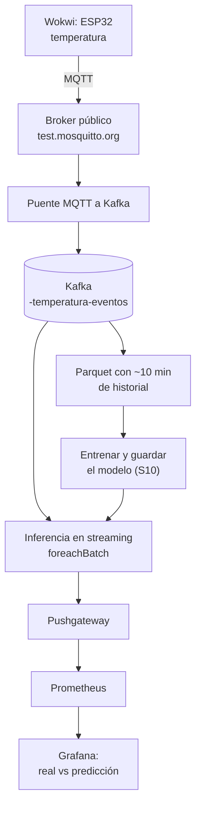

# Examen final práctico de Big Data — Variante 4: temperatura (práctica)

## 1. Propósito

**Este examen se desarrolla sobre tu propio proyecto: usas tu Kafka, tu PySpark, tu Prometheus, tu Pushgateway y tu Grafana, y agregas un flujo nuevo. No empiezas un proyecto desde cero.**

Demuestras que sabes **extender tu arquitectura Lambda con un flujo nuevo de punta a punta**: un sensor simulado en Wokwi publica lecturas, Kafka las recibe, con ellas entrenas un modelo, lo aplicas en streaming y publicas la lectura real y la predicción en Grafana. Todo lo que necesitas está en las guías de S03, S07, S10 y S11.

## 2. Reglas

- **Duración:** 120 minutos. **Puntaje:** 20 puntos. **Sin IA.**
- **Se construye sobre tu proyecto grupal**: usas tu propio Kafka, PySpark, Prometheus, Pushgateway y Grafana. Los puertos de este documento son los de referencia de `lambda26`; cámbialos por los de tu proyecto si son distintos.
- **El nombre lleva tu nombre.** `<tunombre>` es tu nombre y apellido en minúsculas, sin tildes ni espacios (por ejemplo `angelsullon`). El topic MQTT, el topic de Kafka, el `sensorId` y el `job` del Pushgateway usan ese dato. Un flujo sin tu nombre no se califica.
- **La lectura se verifica en vivo desde Wokwi.** El docente te pide mover el control del sensor y comprueba que el cambio llega hasta Grafana. Si no usas Wokwi y publicas con el productor Python de S07 (3.3), los ítems de la Tabla 3 valen lo que indica la columna «Con productor Python» (hasta 17 puntos en total).
- Un ítem se califica **funcionando en vivo**. Si no lo puedes demostrar funcionando, vale 0.
- Al terminar, el docente pasa por tu equipo y revisa cada ítem en vivo (Tabla 4).

## 3. Qué construyes

No recibes código. Reutilizas el circuito y el programa del ESP32 de S07 (el *sketch*, el archivo `sketch.ino` que corre dentro del microcontrolador y publica las lecturas), ajustados a la variable de esta variante, y lo que ya construiste en S10 y S11.

**Tabla 1. Datos de esta variante**

| Dato | Valor |
|---|---|
| Variable que mides y predices | temperatura (`temperatura`, °C) |
| Rango de la variable | -40 a 80 °C |
| Cómo se lee en Wokwi | sensor DHT22, como en S07 |
| `sensorId` | `esp32-<tunombre>` |
| Topic MQTT (broker público `test.mosquitto.org`) | `lambda26/<tunombre>/temperatura/lecturas` |
| Topic de Kafka | `<tunombre>-temperatura-eventos` |
| `job` del Pushgateway | `lambda26_<tunombre>_ml` |
| Métricas en Prometheus | `lambda26_ml_temperatura_real` y `lambda26_ml_temperatura_prediccion_siguiente` |
| Frecuencia de publicación | 1 lectura por segundo |

**Contrato del evento**

```json
{ "tipoEvento": "sensor.lectura", "sensorId": "esp32-<tunombre>", "temperatura": 21.3, "origen": "wokwi", "timestamp": 1789697567664 }
```

**Figura 1. Flujo del examen**



## 4. Preguntas

### Pregunta 1 — Ingesta: Wokwi, MQTT y Kafka (5 puntos)

**Guías:** S07, pasos 3.7 (puente MQTT a Kafka) y 3.8 (ESP32 en Wokwi).

1. **Circuito y programa (sketch) en Wokwi (2 ptos).** En Wokwi usa el circuito de S07 y ajusta el programa (`sketch.ino`) para leer temperatura (sensor DHT22, como en S07) y publicar cada segundo el contrato de la sección 3 en el topic MQTT de la Tabla 1. El monitor serie muestra cada publicación.
2. **Puente en Python y topic de Kafka (3 ptos).** Ajusta el puente de S07 (`bridge_mqtt_kafka.py`, código Python que lee del topic MQTT) para que reenvíe a tu topic de Kafka (`<tunombre>-temperatura-eventos`), con `sensorId` como llave. Créalo si no existe. En Kafka UI se ven los mensajes llegando.

### Pregunta 2 — Historial y modelo (6 puntos)

**Guías:** S03 (escribir Parquet) y S10, pasos 3.3 a 3.6 (preparación de datos, modelo, evaluación y guardado).

Empieza esta pregunta cuando ya tengas lecturas llegando. El historial son los **10 minutos** de lecturas que se acumulan mientras avanzas (se acepta un mínimo de 5).

1. **Historial en Parquet (2 ptos).** Guarda en Parquet las lecturas de temperatura acumuladas en el topic (unas 600 con 1 lectura por segundo). Muestra el conteo.
2. **Dataset supervisado y división (2 ptos).** Construye el `label` con `lead(temperatura, 1)` en orden cronológico y divide 80/20 **por posición en el tiempo**, no al azar.
3. **Modelo y baseline (2 ptos).** Evalúa primero el baseline de persistencia (predecir el valor actual), entrena `LinearRegression`, compara el RMSE (raíz del error cuadrático medio) de ambos y guarda el modelo. No se califica que el modelo gane al baseline, sino que la comparación sea correcta y honesta.

### Pregunta 3 — Inferencia en streaming (4 puntos)

**Guías:** S10, paso 3.7 (inferencia en tiempo real).

1. **Inferencia en streaming, en el cuaderno (4 ptos).** En tu cuaderno de Jupyter, recarga el modelo guardado y aplícalo con `foreachBatch` sobre el topic de Kafka. Cada lectura nueva produce una predicción de temperatura para la lectura siguiente, visible en la salida de la celda o en un Parquet. Aquí no se usa Grafana: el tablero es la pregunta 4.

### Pregunta 4 — Grafana (5 puntos)

**Guías:** S11, pasos 3.4 (Pushgateway y Prometheus), 3.8 y 3.9 (publicar y confirmar cada predicción) y 3.11 (tablero de Grafana).

**Figura 2. Prototipo del panel**

```text
+--------------------------------------------+
| Tablero: temperatura                       |
+--------------------------------------------+
| linea 1: valor real                        |
| linea 2: predicción siguiente              |
|                                            |
|   ~~~~/\~~~~/\~~~~   (se mueve en vivo)    |
|                                            |
+--------------------------------------------+
```

1. **Publicar en el Pushgateway (2 ptos).** En cada micro-lote publica la lectura real y la predicción con el `job` y las métricas de la Tabla 1, como en S11.
2. **Prometheus las ve (1 pto).** Consulta las dos métricas en Prometheus y devuelven valores.
3. **Panel de Grafana en vivo (1 pto).** Un panel *Time series* en Grafana con las dos series de temperatura, que cambian entre un *refresh* y el siguiente.
4. **Cambio en vivo desde Wokwi (1 pto).** El docente te pide mover el control del sensor en Wokwi: el valor cambia en el monitor serie, aparece un mensaje nuevo en Kafka UI y el panel se mueve.

## 5. Calificación

**Tabla 3. Puntaje por ítem**

| Pregunta | Ítem | Con Wokwi | Con productor Python | Puntaje obtenido |
|---|---|---|---|---|
| 1 | Circuito y programa (sketch) en Wokwi: temperatura | 2 | 1 | |
| 1 | Puente en Python y topic `<tunombre>-temperatura-eventos` | 3 | 1.5 | |
| 2 | Historial de temperatura en Parquet | 2 | 2 | |
| 2 | Dataset supervisado y división sobre `temperatura` | 2 | 2 | |
| 2 | Modelo y baseline de temperatura | 2 | 2 | |
| 3 | Inferencia en streaming de temperatura (en el cuaderno) | 4 | 4 | |
| 4 | Publicar `temperatura` real y su predicción en el Pushgateway | 2 | 2 | |
| 4 | Prometheus ve las métricas de `temperatura` | 1 | 1 | |
| 4 | Panel de Grafana en vivo de temperatura | 1 | 1 | |
| 4 | Cambio en vivo: mover temperatura en Wokwi | 1 | 0.5 | |
| | **Total** | **20** | **17** | |

Con el productor Python de S07 el máximo es 17. Los ítems que dependen de datos que no llegaron se califican 0 sin descontar otra vez el mismo error.

**Tabla 4. Qué revisa el docente en vivo**

| Pregunta | Qué mira |
|---|---|
| 1 | El monitor serie de Wokwi, Kafka UI (`<tunombre>-temperatura-eventos`, llave `sensorId`) |
| 2 | La carpeta Parquet con su conteo, el dataset con `lead`, y el RMSE del baseline y del modelo |
| 3 | La salida de `foreachBatch` en el cuaderno: una predicción por cada lectura nueva |
| 4 | Prometheus (consulta de las dos métricas) y el panel de Grafana mientras el docente mueve el sensor en Wokwi |

**Tabla 5. Tiempo sugerido**

| Pregunta | Minutos |
|---|---|
| 1 Ingesta (cerrarla en los primeros 25: el historial empieza a juntarse al publicar) | 35 |
| 2 Historial y modelo | 35 |
| 3 Inferencia | 20 |
| 4 Grafana | 20 |
| Margen y revisión en vivo | 10 |
