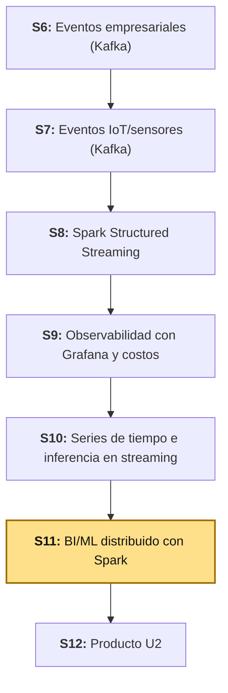
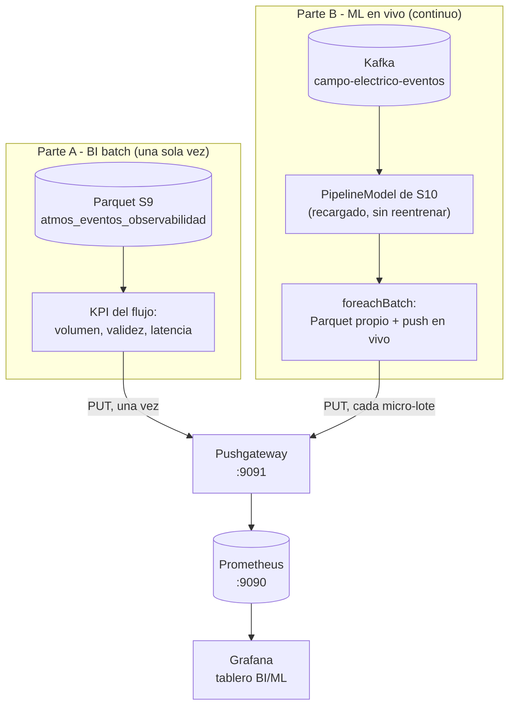

# S11 - BI/ML distribuido con Spark

## 1. Introducción

Tiempo: 20 min.

### 1.1 Presentación de la sesión

S9 dejó un Grafana mostrando si la infraestructura está sana (brokers, *lag*, latencia de Spark). S10 entrenó y guardó un modelo de series de tiempo, y lo aplicó en vivo sobre un stream de Kafka — pero esas predicciones solo quedaron escritas en Parquet (`predicciones_stream`), sin llegar nunca a ningún tablero mientras el stream corría. Hoy la sesión hace dos cosas distintas, con dos mecanismos de publicación distintos:

- **BI batch** (Parte A): un notebook lee, una sola vez, el Parquet de observabilidad que S9 ya cerró, calcula tres KPIs del flujo de eventos, y los publica una sola vez en Prometheus a través de un **Pushgateway** — el mecanismo correcto para un *job* que corre una vez y termina, porque Prometheus solo sabe *ir a buscar* datos de un *target* que sigue vivo para responder.
- **ML en vivo** (Parte B): el mismo notebook vuelve a desplegar el modelo que S10 ya entrenó y guardó — no se reentrena nada — contra el mismo stream de Kafka de S10, y esta vez **sí** publica en vivo: cada micro-lote que el modelo predice empuja su resultado al mismo Pushgateway, en el momento en que ocurre, mientras el stream sigue corriendo. El panel de Grafana que resulta de esto ya no es una foto fija — es una línea que crece mientras miras, como la que ya viste en la comparación entrenamiento → prueba → *streaming* de S10.

### 1.2 Índice

1. KPI de negocio frente a métrica de infraestructura y de aplicación (continuación de S9).
2. Pushgateway: la herramienta correcta para un *job* batch, y un atajo pragmático —no la forma recomendada— para uno que no termina.
3. Error de predicción en producción, medido en vivo (continuación de S10 y la Regla #37).
4. Tablero de BI en Grafana: un panel estático (batch) y uno realmente en vivo (streaming), lado a lado.

### 1.3 Propósito de aprendizaje

Al concluir la clase, estarás en condiciones de:

- **Calcular** KPIs de negocio sobre evidencia ya persistida de un pipeline de streaming, **redesplegar** un modelo ya entrenado sobre un stream de Kafka en vivo sin reentrenarlo, **publicar** métricas en Prometheus a través de un Pushgateway tanto para un *job* batch como —con criterio, sabiendo que es un atajo— para uno continuo, y **distinguir**, en Grafana, un panel que nunca cambia de uno que de verdad evoluciona en tiempo real.

### 1.4 Producto de sesión

Notebook `11_bi_ml_distribuido.ipynb` con dos partes. La primera reutiliza, sin recalcularlo, el Parquet de observabilidad de S9 (`atmos_eventos_observabilidad`): tres KPIs del flujo de eventos (volumen, ratio de eventos válidos, latencia promedio), publicados una sola vez en un nuevo servicio **Pushgateway** agregado a `obs/`. La segunda vuelve a leer `campo-electrico-eventos` en vivo, recarga el `PipelineModel` que S10 ya entrenó y guardó, y en cada micro-lote publica la lectura real y la predicción del minuto siguiente en el mismo Pushgateway — sin esperar a que el stream termine. Un tablero de Grafana con un panel *Stat* (el KPI batch) y un panel *Time series* genuinamente en vivo (la predicción), junto a los paneles de infraestructura de S9.

### 1.5 Metodología

**Tabla 1. Metodología de la sesión**

| Actividades a Realizar en el Periodo | Orientaciones generales (Orientaciones Metodológicas) | Material de estudio recomendado |
|---|---|---|
| Revisión previa individual | Confirmar que el Parquet de S9 (`atmos_eventos_observabilidad`) sigue existiendo y que el modelo guardado de S10 (`artifacts/models/modelo_ce_lr`) sigue ahí. Repasar la Tabla 4 de S9 ("dos tipos de métrica") y la Tabla 5 de S10 (comparación contra el baseline). Trabajo individual, antes de clase. | S9 (2.4, Tabla 4), S10 (3.5.1, Tabla 5; 3.7). |
| Clase presencial | Construcción guiada del notebook `11_bi_ml_distribuido.ipynb`: KPI del flujo de eventos en Pushgateway (batch), redespliegue del modelo de S10 contra Kafka en vivo, publicación en vivo micro-lote por micro-lote, verificación de que las métricas de verdad cambian en Prometheus, y armado del tablero de Grafana. Trabajo individual, siguiendo al docente paso a paso. | Pasos 3.1 a 3.12 de esta guía. |
| Evaluación formativa | Revisión en clase del panel batch y del panel en vivo en Grafana, confirmando con PromQL que el segundo cambia entre una consulta y la siguiente. La evidencia se completa y sustenta de forma individual, fuera del aula, según los criterios mínimos de la sección 4.4. | Indicaciones de entrega (4.3), rúbrica de evaluación (4.6). |

### 1.6 Motivación de la sesión

#### 1.6.1 Caso: la regla 37 de Google y la diferencia entre el laboratorio y la producción

Google publica, desde hace más de una década, una guía interna hecha pública llamada *Rules of Machine Learning* — un conjunto de reglas prácticas para llevar modelos a producción, escritas por ingenieros que ya habían visto fallar lo suficiente como para documentarlo. La Regla #37 se llama, literalmente, **"Mide el *skew* entre entrenamiento y servicio"** (*Measure Training/Serving Skew*), y describe tres comparaciones distintas que hay que hacer, no una sola: entrenamiento contra datos de prueba, datos de prueba contra datos del día siguiente, y —la que importa hoy— **datos del día siguiente contra datos en vivo**. Esa última comparación es, explícitamente, la que detecta si el modelo que funcionaba bien en el laboratorio sigue funcionando igual una vez que está recibiendo datos reales de producción (Google, 2024).

Fuente: Google. (2024). *Rules of Machine Learning: Rule #37 — Measure Training/Serving Skew*. https://developers.google.com/machine-learning/guides/rules-of-ml

S10 (3.5.1) ya hizo la primera comparación de la regla —entrenamiento contra prueba— y reportó con honestidad que `LinearRegression` apenas ganó al baseline por un `0.68%` de RMSE. Lo que faltaba —y es la pieza que esta sesión agrega— es que esa última comparación no sea un chequeo que se hace una vez y se olvida: hoy el modelo queda publicando, lectura por lectura, lo que predice frente a lo que después resulta cierto, en el mismo lugar donde cualquiera puede mirarlo mientras ocurre, no solo en un archivo que hay que abrir a mano.

**Preguntas de análisis**

**Activación de conocimientos previos**

1. En S10, ¿qué métrica se usó para decidir si `LinearRegression` era mejor que el baseline, y sobre qué datos se calculó —los de prueba, o los de producción?

**Comprensión de KPIs de negocio y monitoreo en producción**

1. Según la Regla #37, ¿por qué no basta con medir el error de un modelo una sola vez, antes de desplegarlo?
2. ¿Qué diferencia hay entre un KPI de negocio (como el ratio de eventos válidos) y una métrica de infraestructura (como el *lag* de Kafka de S9)?

### 1.7 Ubicación en el curso

- Unidad: U2 - Sistema Big Data en tiempo real: ingesta, streaming, observabilidad y BI/ML.
- Producto del curso: Proyecto Sello: sistema Big Data distribuido end-to-end para procesamiento batch y streaming, analítica/ML, observabilidad y visualización BI para la toma de decisiones.
- Producto de unidad: pipeline en tiempo real con ingesta de eventos empresariales e IoT/sensores, procesamiento streaming con Spark, observabilidad/costos y salidas BI/ML distribuidas.
- Avance del producto en esta sesión: los KPIs del flujo de eventos (batch) y la predicción del modelo de S10 redesplegada en vivo, ambos visibles en el mismo Grafana — la capa de BI/ML que cierra la Unidad II antes de su integración en S12.

**Figura 1. Roadmap del producto de la Unidad II**



## 2. Explica

Tiempo: 30 min.

### 2.1 Arquitectura de la sesión

**Figura 2. Dos patrones de publicación, un mismo Pushgateway**



Lectura del diagrama: las dos partes terminan en el mismo Pushgateway y el mismo tablero, pero con una diferencia que importa — la Parte A empuja **una vez** y termina; la Parte B empuja **repetidamente**, mientras el stream de Kafka sigue vivo. Esa diferencia es exactamente lo que 2.3 explica con detalle: el Pushgateway está pensado para la primera, no para la segunda.

### 2.2 KPI de negocio frente a métrica de infraestructura y de aplicación

S9 (2.4, Tabla 4) ya distinguió dos tipos de métrica: infraestructura (vive en Kafka/`kafka-exporter`) y aplicación (se calcula dentro de Spark, como `latencyMs`). Hoy aparece un tercer tipo, que ninguna de las dos anteriores cubre.

**Tabla 2. Tres tipos de métrica, con su ejemplo de esta Unidad**

| Tipo | Ejemplo | Responde |
|---|---|---|
| Infraestructura (S9) | `kafka_consumergroup_lag` | ¿Está sano el *broker*/consumidor? |
| Aplicación (S9) | `latencyMs` de un evento | ¿Qué tan rápido procesa *este* pipeline? |
| **Negocio / BI (hoy)** | Ratio de eventos válidos, predicción del modelo en producción | ¿El *dato* que le está llegando al negocio es bueno, y la *predicción* que se le ofrece es confiable? |

Ninguna herramienta de infraestructura puede calcular esta tercera columna por sí sola: un *exporter* no sabe qué es un evento "válido" para `atmos-eventos`, ni qué significa que una predicción sea "buena" — esas son reglas del dominio, igual que `isValid` ya lo era en S9 (2.4).

### 2.3 Pushgateway: la herramienta correcta para un *job* que termina — y un atajo para uno que no

Prometheus funciona por *pull*: visita cada *target* en su propio `scrape_interval` (S9, 2.3). Eso asume que el *target* sigue vivo para responder cuando Prometheus toque la puerta. La Parte A de hoy (el KPI del flujo) calcula tres números y termina — para cuando Prometheus quisiera *scrapearla*, el proceso ya no existe.

La documentación oficial de Prometheus describe exactamente este caso: el Pushgateway existe para monitorear "componentes que no se pueden *scrapear*", permitiendo que *jobs* batch de corta duración **empujen** sus métricas a un intermediario, al que Prometheus sí puede *scrapear* con normalidad (Prometheus Authors, 2024b).

**Tabla 3. Quién empuja, quién va a buscar**

| | `kafka-exporter` (S9) | Parte A — KPI del flujo (hoy) | Parte B — predicción en vivo (hoy) |
|---|---|---|---|
| ¿Vive corriendo todo el tiempo? | Sí — servicio permanente | No — corre una vez y termina | Sí — mientras el stream esté activo |
| ¿Cómo llegan sus métricas a Prometheus? | Prometheus lo visita (*pull*) | El propio *job* las empuja una vez (*push*) | El propio *job* las empuja repetidamente (*push*) |
| ¿Es Pushgateway la herramienta recomendada aquí? | No aplica (ya es *pull*) | **Sí** — exactamente el caso que documenta | **No, estrictamente** — ver más abajo |

La Parte B de hoy es, en rigor, el caso que la propia documentación de Prometheus desaconseja: un *job* de larga duración podría exponer su propio *endpoint* `/metrics` y dejar que Prometheus lo *scrapee* directamente (*pull*), igual que `kafka-exporter` — eso es lo recomendado para algo que vive corriendo. Usamos el Pushgateway igual, por una razón pragmática y no por ser la forma correcta: levantar un servidor HTTP propio dentro del *driver* de Spark, accesible desde la red de Docker, es más infraestructura de la que esta sesión necesita para el punto que quiere enseñar. El costo de ese atajo: si dos corridas de esta sesión publican a la vez bajo la misma `instance`, una pisa a la otra (2.4 ya explica por qué `PUT` reemplaza el grupo completo) — en un *job* batch de una sola corrida esto nunca pasa; en un *job* que vive publicando todo el tiempo, sí es un riesgo real a tener en cuenta.

**Tabla 4. `PUT` frente a `POST` al publicar en el Pushgateway**

| Método | Qué hace con el grupo (`job`/`instance`) existente |
|---|---|
| `PUT` | Reemplaza **todo** el grupo por las métricas de este *push* (Prometheus Pushgateway Maintainers, 2024c) |
| `POST` | Reemplaza solo las métricas que coincidan por nombre; el resto del grupo queda intacto (Prometheus Pushgateway Maintainers, 2024c) |

3.4 y 3.8 usan `PUT` — en la Parte A porque cada corrida recalcula el estado completo de los tres KPIs; en la Parte B porque cada micro-lote reemplaza por completo el único par de valores (real, predicha) de esa `estacionId`, sin dejar un valor viejo mezclado con uno nuevo.

### 2.4 Error de predicción en producción, ahora en vivo

El caso de 1.6 ya lo planteó: la Regla #37 de Google pide comparar la predicción contra lo que de verdad ocurrió después, no solo contra el conjunto de prueba.

**Tabla 5. Tres formas de responder la misma pregunta, de menos a más cercana al "en vivo" de la Regla #37**

| | S10 (3.5.1) | Auditoría *post-hoc* (3.10, opcional) | Parte B de hoy, en vivo (3.8) |
|---|---|---|---|
| Pregunta | ¿Qué tan bueno es el modelo, medido *antes* de desplegarlo? | ¿Qué tan bueno fue el modelo, en lo ya recolectado hasta ahora? | ¿Qué tan cerca está la predicción de lo real, en este instante? |
| Datos | 20% de prueba, separado cronológicamente del entrenamiento | El propio Parquet que el stream de hoy ya escribió, comparando el batch `N` contra el `N+1` | El último valor real y la última predicción, publicados en el momento en que el *foreachBatch* los calculó |
| Cuándo se calcula | Una sola vez, antes de guardar el modelo | Después de detener la consulta, releyendo lo recolectado | Continuamente, mientras el stream sigue corriendo |

La mecánica de 3.10 reutiliza la misma técnica que uniría la predicción del batch `N` (que predice el minuto `N+1`) con el valor real de `CE` que la propia tabla ya trae en la fila `N+1` — sin esperar ningún dato nuevo, el "futuro" de la predicción del batch 1 ya está en el batch 2. La diferencia con la Parte B es que esa auditoría se hace **después**, sobre un archivo; la Parte B lo muestra **mientras ocurre**, sin tener que esperar a que termine nada.

### 2.5 Tablero de Grafana: un panel estático y uno realmente en vivo

El tablero de hoy no reemplaza al de S9 — lo complementa, y además contrasta dos comportamientos distintos a propósito. El panel del KPI del flujo (Parte A) es una foto fija: se calculó una vez, Prometheus la repite en cada *scrape* hasta que alguien vuelva a correr el notebook. El panel de la predicción (Parte B) es, por primera vez en este curso, un panel que de verdad cambia solo, sin que nadie vuelva a tocar nada — porque la Parte B sigue empujando valores nuevos mientras el stream de Kafka sigue vivo. Ver los dos lado a lado es la forma más directa de que la diferencia quede clara sin tener que explicarla dos veces.

## 3. Aplica: actividad práctica guiada

Tiempo: 2h 30 min.

**Actividad:** construir el notebook `11_bi_ml_distribuido.ipynb` en dos partes — un KPI batch del flujo de eventos de S9 publicado una vez en Pushgateway, y el modelo de S10 redesplegado contra Kafka en vivo, publicando cada predicción en el mismo Pushgateway micro-lote por micro-lote — y visualizar ambas en un tablero de Grafana.

**Propósito de la actividad:** dejar evidencia ejecutable de que puedes convertir evidencia ya persistida en KPIs de negocio, redesplegar un modelo ya entrenado sin reentrenarlo, publicar métricas en Prometheus con el patrón correcto para cada tipo de *job* (batch y continuo), y reconocer con criterio cuándo ese patrón es un atajo pragmático y no la recomendación oficial.

**Orientaciones metodológicas:** en clase, el docente guía la construcción del notebook y del tablero paso a paso; los estudiantes replican cada celda sobre su propia evidencia de S9/S10 — si algún equipo no completó S9 o S10 por completo, puede avanzar igual con lo que sí tenga, documentando el volumen real disponible.

**Actividades para realizar:**

- **3.1** Reanudar el entorno y agregar el servicio Pushgateway a `obs/`.
- **3.2** Crear el notebook y cargar el Parquet real de S9.
- **3.3** Calcular el KPI del flujo de eventos.
- **3.4** Publicar el KPI del flujo en Pushgateway y verificarlo en Prometheus.
- **3.5** Levantar de nuevo el productor de `campo-electrico-eventos`.
- **3.6** Cargar el modelo que S10 ya entrenó y guardó.
- **3.7** Leer el stream y aplicar el modelo, sin ventanas ni estado.
- **3.8** Publicar cada predicción en el Pushgateway, micro-lote por micro-lote.
- **3.9** Confirmar que las métricas de verdad cambian en Prometheus.
- **3.10** (Opcional) Detener la consulta y auditar lo recolectado, igual que la Regla #37 pide.
- **3.11** Armar el tablero de Grafana.
- **3.12** Relacionar con el cierre de la Unidad II.

### 3.1 Reanudar el entorno y agregar el servicio Pushgateway a `obs/`

**Producto del paso:** `obs/` con un tercer servicio (`pushgateway`), confirmado como *target* `UP` en Prometheus.

```bash
cd pyspark
docker compose -f compose.yml -f compose.kafka.yml up -d
```

Agrega el servicio `pushgateway` a **`obs/compose.yml`**, junto a `prometheus` y `grafana` (no reemplaces los dos que ya tenías, solo agrega este bloque):

```yaml
  pushgateway:
    image: prom/pushgateway:v1.11.1
    container_name: lambda26-pushgateway
    restart: unless-stopped
    ports:
      - "49091:9091"
    networks:
      - lambda26-kafka-net
```

Y el *scrape job* correspondiente en **`obs/prometheus/prometheus.yml`**:

```yaml
  - job_name: pushgateway
    honor_labels: true
    metrics_path: /metrics
    static_configs:
      - targets:
          - pushgateway:9091
```

`honor_labels: true` es la recomendación oficial para *scrapear* un Pushgateway: sin ella, Prometheus sobrescribiría con sus propias etiquetas (`instance`, `job`) las que el propio *push* ya traía, perdiendo precisamente la información que identifica de dónde vino cada métrica (Prometheus Authors, 2024b).

```bash
cd ../obs
docker compose up -d
```

Verifica en `http://localhost:49090` (**Status → Targets**) que `pushgateway` aparece `UP`, junto a `prometheus` y `kafka-exporter` (S9).

**Error frecuente**: si `pushgateway` no aparece en la lista de *targets*, confirma que el `docker compose up -d` se corrió **dentro de `obs/`** (no desde la raíz del repo) y que el contenedor `lambda26-pushgateway` está arriba (`docker ps`) — el mismo tipo de error de red que ya viste con Grafana y Prometheus en S9 (3.1).

### 3.2 Crear el notebook y cargar el Parquet real de S9

**Producto del paso:** notebook `11_bi_ml_distribuido.ipynb` con una `SparkSession` capaz de leer Parquet y, más adelante en la Parte B, Kafka — y el DataFrame de observabilidad de S9 cargado y contado.

```python
from pyspark.sql import SparkSession
from pyspark.sql import functions as F

spark = (
    SparkSession.builder
    .appName("sesion11-bi-ml-distribuido")
    .master("local[*]")
    .config("spark.jars.packages", "org.apache.spark:spark-sql-kafka-0-10_2.13:4.2.0")
    .config("spark.sql.shuffle.partitions", "8")
    .getOrCreate()
)
spark.sparkContext.setLogLevel("ERROR")
spark
```

El conector de Kafka se declara aquí mismo, igual que en S8-S10, aunque no haga falta hasta 3.7 (Parte B) — una `SparkSession` ya creada no puede agregar `spark.jars.packages` después; si la creas sin esta línea, la única forma de corregirlo es reiniciar el *kernel* y volver a correr esta celda ya con el conector declarado, no solo volver a ejecutarla tal cual. `spark.sql.shuffle.partitions` en `8` es el mismo ajuste de S10 (3.1.1) para el topic `campo-electrico-eventos`, no el valor por defecto de `200` pensado para datos mucho más grandes.

**Error frecuente**: `AnalysisException: Failed to find data source: kafka` al llegar a 3.7. Significa que la `SparkSession` activa se creó sin `spark.jars.packages` — revisa si copiaste esta celda completa o si la `SparkSession` de una corrida anterior (sin el conector) sigue viva en el *kernel*. **Kernel → Restart Kernel and Run All** desde el principio es la forma correcta de corregirlo, no solo volver a correr esta celda sola.

```python
RUTA_EVENTOS_S9 = "../s09-observabilidad-pipeline/artifacts/atmos_eventos_observabilidad"

eventos = spark.read.parquet(RUTA_EVENTOS_S9)

print(f"Filas eventos (S9): {eventos.count():,}")
```

En una corrida real: **1,866** filas de eventos — el volumen real que S9 dejó guardado al momento de correr este notebook. Si tu propio conteo es distinto, no hay problema: es exactamente el volumen real que tu notebook de S9 dejó guardado, y es sobre ese volumen que corre el resto de la Parte A.

**Error frecuente**: `Path does not exist` al leer la ruta. No se repite el streaming de S9 hoy — si no llegaste a correr completa esa sección (S9, 3.8), vuelve a esa guía y completa solo esa persistencia antes de seguir aquí; no hace falta rehacer la sesión completa.

### 3.3 Calcular el KPI del flujo de eventos

**Producto del paso:** tres números reales —volumen, ratio de válidos, latencia promedio— que resumen la salud del flujo de eventos como KPI de negocio (2.2).

```python
kpi_eventos = eventos.agg(
    F.count("*").alias("total"),
    F.avg(F.col("isValid").cast("int")).alias("ratioValidos"),
    F.avg("latencyMs").alias("avgLatencyMs"),
).first()

print(f"Eventos procesados:   {kpi_eventos['total']}")
print(f"Ratio de validos:     {kpi_eventos['ratioValidos']:.4f}")
print(f"Latencia promedio:    {kpi_eventos['avgLatencyMs']:.2f} ms")
```

Verificado contra la evidencia real de S9: **1,866** eventos, ratio de válidos **1.0000** (todos cumplieron el contrato mínimo de S7), y latencia promedio **398793.10 ms** (~6.6 minutos).

**Este último número merece atención, no solo reportarse — y por un margen mucho mayor del que podrías esperar.** La Tabla 8 de S9 propuso `avgLatencyMs > 1000` (un segundo) como umbral de "Latencia alta crítica" — el valor real de esta evidencia lo supera por varios órdenes de magnitud. No es un error del cálculo: `latencyMs = processedAt - timestamp` (S9, 3.5) mide cuánto tardó cada evento en viajar desde que se publicó hasta que Spark lo procesó — un promedio tan alto, sobre 1,866 eventos, indica que buena parte de ellos esperaron minutos u horas reales antes de ser leídos, consistente con un `atmos_eventos_observabilidad` que acumuló evidencia de más de una corrida del pipeline, con intervalos reales entre sesión y sesión — muy distinto de un pipeline de producción corriendo sin interrupciones. Lo que sí es un hallazgo real y honesto: la propuesta de alertas de S9 no era un ejercicio teórico — esta misma evidencia ya la habría disparado, y por un margen que ningún umbral razonable dejaría pasar. Documenta este resultado tal como salga en tu propia evidencia, sea cual sea.

### 3.4 Publicar el KPI del flujo en Pushgateway y verificarlo en Prometheus

**Producto del paso:** las tres métricas del flujo de eventos, publicadas una sola vez en el Pushgateway y confirmadas con PromQL real.

```python
import urllib.request

metricas_flujo = {
    "lambda26_bi_eventos_total": kpi_eventos["total"],
    "lambda26_bi_eventos_validos_ratio": kpi_eventos["ratioValidos"],
    "lambda26_bi_latencia_promedio_ms": kpi_eventos["avgLatencyMs"],
}

lineas = []
for nombre, valor in metricas_flujo.items():
    lineas.append(f"# TYPE {nombre} gauge")
    lineas.append(f"{nombre} {valor}")
cuerpo = "\n".join(lineas) + "\n"

PUSHGATEWAY_FLUJO_URL = "http://pushgateway:9091/metrics/job/lambda26_bi_flujo/instance/s11_batch"
peticion = urllib.request.Request(PUSHGATEWAY_FLUJO_URL, data=cuerpo.encode("utf-8"), method="PUT")
with urllib.request.urlopen(peticion) as respuesta:
    print("Pushgateway respondio:", respuesta.status)
```

Un `status: 200` confirma que el Pushgateway aceptó el grupo completo (`job=lambda26_bi_flujo`, `instance=s11_batch`, 2.3). Verifica que Prometheus ya las tiene, antes de abrir Grafana:

```python
import json

for nombre in metricas_flujo:
    url = f"http://prometheus:9090/api/v1/query?query={nombre}"
    resultado = json.load(urllib.request.urlopen(url))
    valores = resultado["data"]["result"]
    if valores:
        print(f"{nombre}: {valores[0]['value'][1]}")
    else:
        print(f"{nombre}: SIN DATOS (revisa 3.1)")
```

Si alguna métrica sale "SIN DATOS", espera al menos un `scrape_interval` (15s, S9 2.3) desde el `PUT` — Prometheus no las tiene hasta su próximo *scrape* al Pushgateway, no son instantáneas.

### 3.5 Levantar de nuevo el productor de `campo-electrico-eventos`

**Producto del paso:** el productor de S10 (`uso-campo-electrico`) publicando de nuevo, con sus lecturas sintéticas llegando a Kafka.

S10 (3.7.1) ya construyó este productor — hoy solo se vuelve a levantar, no se reconstruye nada:

```bash
cd uso-campo-electrico
docker compose up -d
docker exec -it lambda26-uso-campo-electrico python producer_campo_electrico.py
```

**Error frecuente**: si el contenedor ya existía pero estaba detenido (`docker ps -a` lo muestra `Exited`), `docker compose up -d` lo vuelve a levantar sin reconstruir nada — no hace falta `--build`. Si la primera lectura falla con `NotLeaderForPartitionError`, es el mismo caso ya documentado en S10 (3.7.1): el topic tarda una fracción de segundo en elegir líder de partición la primera vez. Vuelve a correr el comando.

### 3.6 Cargar el modelo que S10 ya entrenó y guardó

**Producto del paso:** el mismo `PipelineModel` que S10 guardó en 3.6.1, recargado aquí — sin reentrenar nada.

```python
from pyspark.ml import PipelineModel

RUTA_MODELO_S10 = "../s10-series-tiempo-inferencia-streaming/artifacts/models/modelo_ce_lr"

modelo_cargado = PipelineModel.load(RUTA_MODELO_S10)
print("Modelo cargado desde:", RUTA_MODELO_S10)
```

`PipelineModel.load` reconstruye el `Pipeline` completo —`VectorAssembler` y `LinearRegression` incluidos— a partir de lo que S10 guardó; no hace falta volver a importar `VectorAssembler` ni `LinearRegression` aquí, ni repetir el ensamblado de variables a mano (S10, 3.6.1).

**Error frecuente**: `Path does not exist` en `RUTA_MODELO_S10`. Si no llegaste a correr S10 3.6.1 hasta el final, no hay ningún modelo guardado que cargar — vuelve a esa sección y complétala antes de seguir aquí.

### 3.7 Leer el stream y aplicar el modelo, sin ventanas ni estado

**Producto del paso:** un DataFrame de streaming con la predicción del modelo aplicada a cada lectura que llega, idéntico en mecánica a S10 (3.7.2).

```python
from pyspark.sql.types import StructType, StringType, DoubleType, LongType

esquema_evento = (
    StructType()
    .add("tipoEvento", StringType())
    .add("estacionId", StringType())
    .add("CE", DoubleType())
    .add("CM", DoubleType())
    .add("TempOut", DoubleType())
    .add("OutHum", DoubleType())
    .add("WindSpeed", DoubleType())
    .add("Bar", DoubleType())
    .add("SolarRad", DoubleType())
    .add("UVIndex", DoubleType())
    .add("origen", StringType())
    .add("timestamp", LongType())
)

crudo = (
    spark.readStream.format("kafka")
    .option("kafka.bootstrap.servers", "kafka:9092")
    .option("subscribe", "campo-electrico-eventos")
    .option("startingOffsets", "latest")
    .option("failOnDataLoss", "false")
    .load()
)

eventos_stream = (
    crudo.select(F.col("value").cast("string").alias("json_str"))
    .select(F.from_json(F.col("json_str"), esquema_evento).alias("e"))
    .select("e.*")
)

predicciones_stream = modelo_cargado.transform(eventos_stream)
```

Igual que en S10: nada de `withWatermark` ni `groupBy(window(...))` — el modelo transforma cada fila tal como llega, una lectura basta para predecir (S10, 2.6). `startingOffsets="latest"` es deliberado: a diferencia de S10 (que podía partir desde donde quedó el *checkpoint*), hoy conviene arrancar desde las lecturas que lleguen a partir de ahora, no desde el historial completo del topic.

### 3.8 Publicar cada predicción en el Pushgateway, micro-lote por micro-lote

**Producto del paso:** cada micro-lote, al procesarse, guardado en el Parquet propio de esta sesión **y** publicado de inmediato en el Pushgateway — sin esperar a que el stream termine.

```python
RUTA_PREDICCIONES_STREAM = "./artifacts/predicciones_stream"
CHECKPOINT_STREAM = "./artifacts/chk_predicciones_stream"
```

```python
import urllib.request

PUSHGATEWAY_BASE = "http://pushgateway:9091/metrics/job/lambda26_ml_streaming/instance"

def publicar_prediccion_en_vivo(estacion_id, ce_real, prediccion):
    cuerpo = (
        "# TYPE lambda26_ml_ce_real gauge\n"
        f"lambda26_ml_ce_real {ce_real}\n"
        "# TYPE lambda26_ml_prediccion_siguiente gauge\n"
        f"lambda26_ml_prediccion_siguiente {prediccion}\n"
    )
    peticion = urllib.request.Request(f"{PUSHGATEWAY_BASE}/{estacion_id}", data=cuerpo.encode("utf-8"), method="PUT")
    urllib.request.urlopen(peticion).close()

def guardar_predicciones_microlote(df_microlote, id_lote):
    filas = df_microlote.count()
    if filas == 0:
        print(f"Micro-lote {id_lote}: sin filas")
        return
    df_microlote.select(
        F.lit(id_lote).alias("batchId"), "estacionId",
        (F.col("timestamp") / 1000).cast("timestamp").alias("fechaHora"), "CE",
        F.col("prediction").alias("prediccionSiguienteCE"),
    ).write.mode("append").parquet(RUTA_PREDICCIONES_STREAM)

    for fila in df_microlote.select("estacionId", "CE", "prediction").collect():
        publicar_prediccion_en_vivo(fila["estacionId"], fila["CE"], fila["prediction"])

    print(f"Micro-lote {id_lote}: {filas} predicciones guardadas y publicadas en vivo")

# Momento 1: arrancar la consulta
consulta_predicciones = (
    predicciones_stream.writeStream
    .foreachBatch(guardar_predicciones_microlote)
    .option("checkpointLocation", CHECKPOINT_STREAM)
    .start()
)
```

El `for` sobre `df_microlote.select(...).collect()` recorre, fila por fila, lo que haya llegado en **ese** micro-lote — casi siempre una sola fila con esta `ESTACION_IDS` del productor (S10, 3.7.1), pero el código no asume eso: si hubiera más de una estación publicando, cada una recibe su propio `PUT`, bajo su propio `instance` (2.3) — el `PUT` de una estación nunca pisa el de otra. `.collect()` trae esas pocas filas al *driver* para poder iterar sobre ellas en Python puro (`urllib.request` no corre dentro de los *executors* de Spark); con el volumen de un micro-lote (una lectura cada pocos segundos, S10 3.7.1) esto no es un problema de rendimiento — sería distinto si el micro-lote trajera miles de filas.

**Con la consulta arrancada, no la detengas todavía.** Igual que en S10 (3.7.2): sigue con el resto de esta guía (3.9 en adelante) con la consulta corriendo en segundo plano, y vuelve recién al final a detenerla — así Prometheus tiene tiempo real de acumular varios *scrapes* sucesivos con valores distintos, no solo uno.

**Error frecuente**: el primer micro-lote suele imprimir `Micro-lote 0: sin filas` — no es un error, Spark dispara el primer micro-lote apenas la suscripción queda lista, casi siempre antes de que el productor haya emitido su primera lectura desde ese instante (mismo caso de S10, 3.7.2).

**Error frecuente (y la demostración más directa del atajo de 2.3)**: detener el productor (3.5) y ver que el panel de Grafana "sigue prediciendo" — las dos líneas siguen apareciendo en cada *refresh*, pero perfectamente planas, repitiendo el mismo valor. No es que el modelo siga prediciendo solo: el Pushgateway **no sabe que el productor murió** — el último valor que `publicar_prediccion_en_vivo` empujó se queda guardado ahí, y Prometheus lo sigue *scrapeando* cada 15s como si fuera dato fresco, porque el Pushgateway no tiene ningún concepto de "esto ya quedó viejo". A diferencia de un *target* por `pull` (como `kafka-exporter`, S9), donde un servicio caído hace que `up` baje a `0` y Prometheus lo note, aquí no hay ninguna señal equivalente — es exactamente el costo que 2.3 ya anticipó. Para confirmarlo, compara el valor de `lambda26_ml_ce_real` en dos momentos después de parar el productor: si es idéntico, está congelado, no en vivo. Para limpiarlo de verdad (no solo esperar a que un `PUT` futuro lo pise):

```powershell
Invoke-WebRequest -Method Delete -Uri "http://localhost:49091/metrics/job/lambda26_ml_streaming/instance/estacion-ns-01"
```

### 3.9 Confirmar que las métricas de verdad cambian en Prometheus

**Producto del paso:** la misma consulta PromQL, repetida dos veces con al menos un `scrape_interval` de diferencia, devolviendo un valor **distinto** — la prueba directa de que esto es en vivo, no una foto fija.

```python
import json
import time

def consultar(nombre):
    url = f"http://prometheus:9090/api/v1/query?query={nombre}"
    resultado = json.load(urllib.request.urlopen(url))
    valores = resultado["data"]["result"]
    return valores[0]["value"][1] if valores else None

primera = consultar("lambda26_ml_ce_real")
print("Primera lectura:", primera)

time.sleep(20)

segunda = consultar("lambda26_ml_ce_real")
print("Segunda lectura (20s despues):", segunda)
```

Si el productor sigue publicando (3.5) y la consulta sigue activa (3.8), `primera` y `segunda` deberían ser distintos — esa diferencia **es** la evidencia de que el panel de Grafana que armas en 3.11 va a moverse solo. Si salen iguales, no necesariamente es un error: puede que el productor no haya publicado una lectura nueva de esa estación en esos 20 segundos (el intervalo por defecto de S10, 3.7.1, es de 3s, así que lo normal es que sí cambie) — reintenta con una espera más larga antes de asumir que algo falló.

### 3.10 (Opcional) Detener la consulta y auditar lo recolectado, igual que la Regla #37 pide

**Producto del paso:** el error real del modelo —comparando cada predicción contra el valor que de verdad llegó después—, calculado sobre lo que el stream de hoy ya dejó guardado en tu propio Parquet.

Detén la consulta cuando ya tengas suficientes minutos reales de lecturas acumuladas:

```python
consulta_predicciones.stop()
```

Relee lo que guardó la Parte B y aplica la misma técnica que respondería la última comparación de la Regla #37 (1.6, 2.4):

```python
predicciones_hoy = spark.read.parquet(RUTA_PREDICCIONES_STREAM)

actual_siguiente = predicciones_hoy.select(
    (F.col("batchId") - 1).alias("batchId"),
    "estacionId",
    F.col("CE").alias("CE_real_siguiente"),
)

comparado = (
    predicciones_hoy.alias("p")
    .join(actual_siguiente.alias("a"), ["batchId", "estacionId"], "inner")
    .select("p.batchId", "p.estacionId", "p.CE", "p.prediccionSiguienteCE", "a.CE_real_siguiente")
    .withColumn("errorAbsoluto", F.abs(F.col("prediccionSiguienteCE") - F.col("CE_real_siguiente")))
)
comparado.orderBy("batchId").show(truncate=False)

kpi_prediccion = comparado.agg(
    F.count("*").alias("totalComparado"),
    F.avg("errorAbsoluto").alias("maeProduccion"),
).first()

print(f"Predicciones comparables: {kpi_prediccion['totalComparado']}")
print(f"MAE en produccion:        {kpi_prediccion['maeProduccion']:.4f}")
```

El truco es el mismo de siempre: restarle `1` a `batchId` antes de unir hace que la predicción hecha **en** el micro-lote `N` se junte con el valor real de `CE` que tu propio Parquet ya trae **en** el micro-lote `N+1` — sin esperar ningún dato nuevo, el "futuro" de cada predicción ya quedó guardado mientras corrías 3.8. Corre esto sobre tu propia evidencia y documenta el `MAE en producción` real que te salga — no hay un número "correcto" esperado, depende de cuánto tiempo dejaste corriendo la consulta y cuántas lecturas reales alcanzó a procesar.

**Error frecuente**: correr esta celda **antes** de detener la consulta. `spark.read.parquet(...)` sobre un directorio al que `foreachBatch` todavía le está escribiendo puede leer un estado a medio escribir — detén primero (`.stop()`), espera a que la consola confirme que terminó, y recién entonces relee.

**Limpia el valor congelado del Pushgateway** (2.3, el mismo hallazgo de 3.8) — si no lo borras, el panel de Grafana sigue mostrando ese último valor como si fuera en vivo, indefinidamente. Puedes hacerlo desde una terminal (`Invoke-WebRequest`, ya visto en 3.8) o, sin salir del notebook, con el mismo `PUSHGATEWAY_BASE` que ya tienes definido:

```python
peticion_borrar = urllib.request.Request(f"{PUSHGATEWAY_BASE}/estacion-ns-01", method="DELETE")
urllib.request.urlopen(peticion_borrar).close()
print("Grupo borrado del Pushgateway")
```

Después de borrarlo, Prometheus deja de tener un valor que *scrapear* para esa `instance` — el panel de Grafana muestra la serie como cortada (sin datos nuevos) en vez de seguir repitiendo el último número, que es la señal honesta de que el *job* ya no está publicando.

### 3.11 Armar el tablero de Grafana

**Producto del paso:** un tablero de Grafana con un panel *Stat* del KPI batch y un panel *Time series* genuinamente en vivo de la predicción, junto a (o además de) la infraestructura de S9.

**Tabla 6. Paneles mínimos del tablero de BI/ML**

| Panel | Consulta | Visualización |
|---|---|---|
| Eventos procesados (batch) | `lambda26_bi_eventos_total` | Stat |
| Ratio de eventos válidos (batch) | `lambda26_bi_eventos_validos_ratio` | Stat (formato en porcentaje, *Unit* → *Percent (0.0-1.0)*) |
| CE real vs. predicción, en vivo | `lambda26_ml_ce_real` y `lambda26_ml_prediccion_siguiente` (dos consultas en el mismo panel) | Time series |

Para el panel en vivo, paso a paso:

1. Abre `http://localhost:43000`, entra con `admin`/`admin` (S9, 3.3).
2. **Dashboards** → **New** → **New dashboard** → **Add visualization**.
3. Elige el *datasource* **Prometheus** (ya viene provisto).
4. En el editor de la consulta, cambia a modo **Code** (arriba a la derecha del panel de consulta) y pega `lambda26_ml_ce_real`.
5. Botón **+ Query** (dentro de la misma pestaña **Query**) para agregar una segunda serie, y pega `lambda26_ml_prediccion_siguiente`.
6. A la derecha, en el panel de visualización, elige **Time series** (debería venir así por defecto).
7. Arriba a la derecha del todo, cambia el rango de tiempo a **Last 5 minutes** y el *refresh* a **5s** — con un rango largo vas a ver un solo punto perdido al final de un gráfico casi vacío, mientras 3.8 recién empieza a correr.
8. Cambia el título del panel (arriba a la izquierda, dice "Panel Title") por algo como `CE real vs. predicción (en vivo)`.
9. (Opcional, para que la leyenda no muestre la etiqueta completa `{__name__=..., instance=..., job=...}`) en cada consulta, **Options** → **Legend** → **Custom**, y escribe `CE real` en la consulta A y `Predicción siguiente` en la B.
10. **Back to dashboard** → **Save dashboard**, nómbralo `S11 - BI/ML distribuido`. Agrega ahí mismo los dos paneles *Stat* del KPI batch (repitiendo el mismo flujo de S9, 3.3, pasos 1-9, con las consultas de la Tabla 6).

**Error frecuente**: dejar el panel en vivo con un rango de tiempo largo (*Last 24 hours*) mientras recién empiezas a correr 3.8 — vas a ver un punto solo, al final de un gráfico casi vacío, y parecerá que no funciona. Acorta el rango a los últimos minutos para ver la línea crecer desde el principio.

### 3.12 Relacionar con el cierre de la Unidad II

El tablero de hoy no es un artefacto aislado: es la pieza que la Unidad II necesitaba para dejar de depender de abrir el notebook de S10 para saber si el modelo sigue funcionando — ahora se ve solo, en el mismo lugar donde ya se monitorea la infraestructura. S12 integra todo lo construido desde S6 —ingesta de eventos empresariales e IoT, *streaming* con Spark, observabilidad y, desde hoy, BI/ML— en el Producto de Unidad II. Si tu Proyecto Sello todavía no tiene un modelo desplegado como el de S10, documenta en 4.1 al menos el KPI del flujo de eventos (3.3-3.4) sobre tu propia evidencia — la parte en vivo puede quedar pendiente hasta que exista un modelo propio que redesplegar.

**Evidencia de aprendizaje:**

- KPI del flujo de eventos (volumen, ratio de válidos, latencia promedio) calculado sobre la evidencia real de S9, publicado una vez en Pushgateway.
- El modelo de S10 redesplegado contra Kafka en vivo, sin reentrenarlo, publicando cada predicción en el momento en que ocurre.
- La misma consulta PromQL devolviendo valores distintos en dos momentos — prueba directa de publicación en vivo.
- Tablero de Grafana con un panel batch y un panel de serie de tiempo genuinamente en vivo.

## 4. Crea: actividad autónoma

Tiempo: 2h 30min fuera del aula.

### 4.1 Actividad

Aplicación del mismo cierre de BI/ML a la evidencia real del **Proyecto Sello** propio del equipo.

Completa y evidencia estas tareas:

1. Sobre tu propio Parquet de observabilidad (equivalente al de S9), calcula al menos dos KPIs de negocio del flujo de eventos (volumen, calidad, latencia u otro que tenga sentido para tu dominio), y publícalos una vez en Pushgateway — igual que 3.2-3.4.
2. Si tu proyecto ya tiene un modelo entrenado y guardado (equivalente al de S10), redespliégalo contra tu propio stream de Kafka en vivo y publica cada predicción en el Pushgateway, micro-lote por micro-lote — igual que 3.6-3.8. Si todavía no tienes un modelo propio, documenta explícitamente esa ausencia y avanza solo con el punto 1.
3. Confirma con al menos dos consultas PromQL, separadas en el tiempo, que tu métrica en vivo de verdad cambió entre una y otra — igual que 3.9.
4. Arma un tablero de Grafana con al menos un panel batch y, si completaste el punto 2, un panel de serie de tiempo en vivo, sobre tus propios datos.

### 4.2 Propósito

Que cada estudiante demuestre, con la evidencia real de su propio Proyecto Sello, que puede traducir datos ya persistidos en KPIs de negocio, redesplegar un modelo ya entrenado contra datos en vivo sin reentrenarlo, y publicar métricas en Prometheus con el patrón correcto para cada tipo de *job*.

### 4.3 Indicaciones

Entrega un PDF con el siguiente nombre:

```text
S11_Equipo##_ApellidoNombre.pdf
```

Cada captura de pantalla del informe debe mostrar, sin recortar, el reloj del sistema (fecha y hora) y tu usuario o foto de perfil (Windows, VS Code o navegador) visibles en pantalla — es lo que permite verificar que la evidencia es tuya y que corresponde al momento real de tu trabajo.

#### 4.3.1 Estructura del informe

**Datos del estudiante**

- Nombre:
- Equipo:
- Sesión: S11 - BI/ML distribuido con Spark
- Rol o aporte realizado:
- Link de GitHub:

**Evidencia técnica**

Incluye capturas o extractos con una breve explicación debajo de cada uno, organizados en los mismos 4 bloques de la rúbrica (4.6):

1. *KPI del flujo de eventos (batch)*
    - Al menos dos KPIs calculados sobre tu propia evidencia persistida, publicados en Pushgateway (equivalente a 3.2-3.4).
2. *Modelo redesplegado en vivo (o su ausencia documentada)*
    - El `foreachBatch` publicando en cada micro-lote, o la justificación explícita de por qué tu proyecto todavía no tiene un modelo que redesplegar (equivalente a 3.6-3.8).
3. *Confirmación de que es en vivo*
    - Dos consultas PromQL, separadas en el tiempo, con un valor distinto entre una y otra (equivalente a 3.9).
4. *Tablero de Grafana*
    - Captura del tablero con el panel batch y, si aplica, el panel en vivo (equivalente a 3.11).

**Error o hallazgo**

Describe un error real: una métrica que salió "SIN DATOS" al principio y por qué, un `PUT` de una estación pisando el de otra por compartir `instance`, o un panel en vivo que parecía no moverse por tener el rango de tiempo mal configurado (3.11).

**Reflexión técnica breve**

Responde en 5 a 8 líneas:

```text
¿Por qué usar el Pushgateway para un job que corre continuamente (como
tu modelo redesplegado) es un atajo y no la forma recomendada, aunque
haya funcionado bien hoy? Relaciona tu respuesta con el caso de la
Regla #37 de Google (1.6) y con tu propia implementacion (o su
ausencia documentada).
```

### 4.4 Criterios mínimos de aceptación

- El archivo respeta el nombre solicitado.
- Al menos dos KPIs de negocio calculados sobre evidencia real propia (no simulada), publicados en Pushgateway.
- Modelo propio redesplegado en vivo contra Kafka, publicando en cada micro-lote, o su ausencia documentada con justificación explícita.
- Al menos dos consultas PromQL, separadas en el tiempo, confirmando un cambio real de valor.
- Tablero de Grafana con al menos un panel batch real.
- Cada captura de la evidencia técnica muestra el reloj del sistema y el usuario/perfil visible, sin recortar.
- Las fechas y horas de las capturas son coherentes con el historial de commits de su repositorio en GitHub.
- Incluye un error o hallazgo técnico diagnosticado.
- Incluye la reflexión técnica breve solicitada.

### 4.5 Preguntas de defensa

1. ¿Por qué un KPI de negocio (como el ratio de eventos válidos) no es lo mismo que una métrica de infraestructura ni que una métrica de aplicación?
2. Según la Regla #37 de Google, ¿qué comparación hace tu panel en vivo que la auditoría *post-hoc* (3.10) no puede hacer?
3. ¿Por qué Prometheus no puede *scrapear* directamente a un notebook que corre una vez y termina?
4. ¿Por qué usar el Pushgateway para el modelo redesplegado en vivo (Parte B) no es la forma recomendada por la propia documentación de Prometheus, aunque haya funcionado?
5. ¿Qué riesgo real introduce agrupar las métricas en vivo por `estacionId` en vez de un valor fijo, si tu proyecto tuviera más de una fuente publicando a la vez?
6. En tu propia implementación (4.1), ¿confirmaste con PromQL que el valor cambió entre una consulta y la siguiente? ¿Qué decisión tomarías si nunca hubiera cambiado?

### 4.6 Rúbrica de evaluación

**Tabla 7. Rúbrica de evaluación**

| Criterio | Peso (%) | A (20 pts) | B (15 pts) | C (10 pts) | D (5 pts) | Nivel obtenido |
|---|---:|---|---|---|---|---:|
| 1. KPI del flujo de eventos (batch)* | 25 | Al menos dos KPIs calculados sobre evidencia real, publicados en Pushgateway y verificados en Prometheus. | KPIs calculados y publicados, verificación parcial. | KPIs calculados sin publicar o sin verificar. | No presenta KPIs del flujo de eventos. | |
| 2. Modelo redesplegado en vivo* | 25 | Modelo propio publicando en cada micro-lote, verificado mientras el stream corre, o ausencia justificada con claridad. | Publicando, con algún micro-lote sin confirmar. | Redespliegue incompleto o solo guardando en Parquet, sin publicar en vivo. | No presenta ningún redespliegue ni justificación de ausencia. | |
| 3. Confirmación de que es en vivo* | 25 | Al menos dos consultas PromQL, separadas en el tiempo, con valores distintos confirmados. | Confirmado, con una sola consulta o evidencia parcial. | Intento de confirmación sin evidencia clara de cambio. | No presenta ninguna confirmación. | |
| 4. Tablero de Grafana* | 25 | Panel batch y panel en vivo reales, con datos correctos. | Al menos un panel real, el otro incompleto. | Tablero incompleto. | No presenta tablero. | |

\* Agregado manual.

Nota final = suma de (`Peso` / 100 × `Puntos del nivel obtenido`) = ____ / 20.

Para usar la rúbrica con IA, solicita:

```text
Evalúa el PDF usando la rúbrica de la sesión.
Para cada criterio selecciona el nivel obtenido usando la escala A=20, B=15, C=10, D=5 puntos.
Justifica brevemente cada nivel asignado.
Verifica que cada captura muestre reloj del sistema y usuario/perfil visible, y que las fechas sean coherentes con el historial de commits de GitHub. Si falta esta evidencia o hay inconsistencias, indícalo explícitamente antes de calificar.
Calcula la nota final con la fórmula: suma de (Peso/100 × Puntos del nivel obtenido), directamente sobre 20.
Indica 2 fortalezas y 2 recomendaciones.
```

## 5. Cierre

Tiempo: 5 min.

**Resumen breve:** hoy el Parquet de observabilidad de S9 se convirtió en un KPI de negocio publicado una sola vez en un nuevo Pushgateway — el patrón correcto para un *job* que corre y termina. Y el modelo que S10 entrenó y guardó volvió a desplegarse, sin reentrenarlo, contra el mismo Kafka en vivo — pero esta vez cada predicción se publicó en el momento en que ocurrió, no se quedó esperando en un archivo. Confirmamos con PromQL que el valor de verdad cambiaba entre una consulta y la siguiente, y lo vimos crecer solo en un panel de Grafana — reconociendo, con honestidad, que usar el Pushgateway para ese segundo caso es un atajo pragmático, no la forma que la propia documentación de Prometheus recomienda.

**Dinámica participativa:** en una ronda rápida, cada estudiante comparte cuánto tiempo dejó corriendo su consulta en vivo, y cuántas predicciones reales alcanzó a acumular antes de detenerla.

**Metacognición:** ¿qué te costó más entender hoy: por qué el Pushgateway es correcto para un *job* batch pero un atajo para uno continuo, o por qué la misma técnica de unir `batchId` con `batchId - 1` sirve tanto para auditar después como para explicar lo que se publica en vivo?

**Proyección:** S12 integra todo lo construido desde S6 —ingesta, *streaming*, observabilidad y, desde hoy, BI/ML en vivo— en el Producto de la Unidad II: un pipeline en tiempo real completo, monitoreado de punta a punta.

## Bibliografía

1. Google. (2024). *Rules of Machine Learning: Rule #37 — Measure Training/Serving Skew*. https://developers.google.com/machine-learning/guides/rules-of-ml
2. Prometheus Authors. (2024b). *Pushing Metrics*. Prometheus Documentation. https://prometheus.io/docs/instrumenting/pushing/
3. Prometheus Pushgateway Maintainers. (2024c). *Pushgateway README* [`PUT`, `POST`, `DELETE`]. GitHub. https://github.com/prometheus/pushgateway/blob/master/README.md
