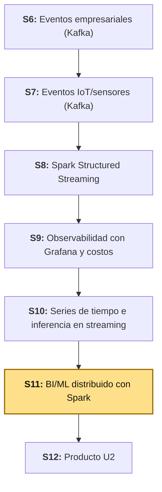
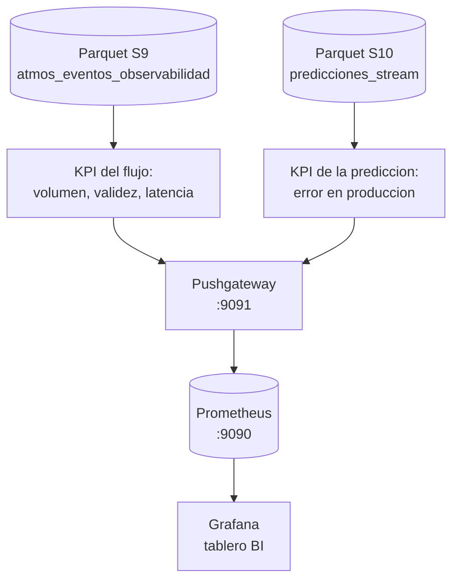

# S11 - BI/ML distribuido con Spark

## 1. Introducción

Tiempo: 20 min.

### 1.1 Presentación de la sesión

S9 dejó un Grafana mostrando si la infraestructura está sana (brokers, *lag*, latencia de Spark). S10 dejó un modelo de series de tiempo aplicado en vivo, con predicciones ya guardadas en Parquet (`predicciones_stream`) — pero esas predicciones nunca llegaron a ningún tablero, se quedaron en un archivo. Hoy se cierra ese círculo: un notebook calcula, sobre la evidencia **ya persistida** por S9 y S10 (no se vuelve a leer Kafka en streaming), KPIs de negocio del flujo de eventos y el error real de la predicción **en producción** —distinto del error de prueba que S10 ya midió offline—, y los publica en el mismo Prometheus de S9 para visualizarlos en Grafana. La pieza nueva de infraestructura es el **Pushgateway**: el mecanismo correcto para que un job que corre una vez y termina (este notebook) le entregue métricas a Prometheus, que solo sabe *ir a buscar* datos, no recibirlos.

El nombre de la sesión no es redundante: trae dos capas distintas, calculadas sobre dos fuentes distintas, y publicadas juntas en el mismo tablero (2.5). La capa **BI** (3.3) audita el *flujo de eventos* de S9 — volumen, ratio de válidos, latencia — y responde "¿es bueno el dato que le está llegando al negocio?". La capa **ML** (3.4) audita el *modelo* de S10 ya desplegado — el error real de sus predicciones contra lo que de verdad ocurrió después, según la Regla #37 (1.6) — y responde "¿sigue siendo bueno el modelo, ahora que está en producción?". Son preguntas distintas, sobre objetos distintos, que comparten el mismo mecanismo de publicación (Pushgateway) y el mismo tablero.

### 1.2 Índice

1. KPI de negocio frente a métrica de infraestructura y de aplicación (continuación de S9).
2. Error de predicción en producción frente al error de prueba offline (continuación de S10).
3. Pushgateway: por qué un job batch no se puede scrapear directamente.
4. Tablero de BI en Grafana: KPIs y predicciones junto a la infraestructura de S9.

### 1.3 Propósito de aprendizaje

Al concluir la clase, estarás en condiciones de:

- **Calcular** KPIs de negocio sobre evidencia ya persistida de un pipeline de streaming, **medir con honestidad** el error real de un modelo en producción (no solo el de prueba), **publicar** esas métricas en Prometheus a través de un Pushgateway, y **visualizarlas** en un tablero de Grafana junto a las métricas de infraestructura ya existentes.

### 1.4 Producto de sesión

Notebook `11_bi_ml_distribuido.ipynb` que reutiliza, sin recalcularlos, el Parquet de observabilidad de S9 (`atmos_eventos_observabilidad`) y el de predicciones en tiempo real de S10 (`predicciones_stream`): tres KPIs del flujo de eventos (volumen, ratio de eventos válidos, latencia promedio) y tres KPIs de la predicción (error absoluto medio en producción, última lectura real, última predicción), calculados con Spark y publicados en un nuevo servicio **Pushgateway** agregado a `obs/`. Un tablero de Grafana con esas seis métricas visualizadas junto a los paneles de infraestructura de S9 (`kafka_brokers`, `kafka_consumergroup_lag`).

### 1.5 Metodología

**Tabla 1. Metodología de la sesión**

| Actividades a Realizar en el Periodo | Orientaciones generales (Orientaciones Metodológicas) | Material de estudio recomendado |
|---|---|---|
| Revisión previa individual | Confirmar que los Parquet de S9 (`atmos_eventos_observabilidad`) y S10 (`predicciones_stream`) siguen existiendo, y repasar la Tabla 4 de S9 ("dos tipos de métrica") y la Tabla 5 de S10 (comparación contra el baseline). Trabajo individual, antes de clase. | S9 (2.4, Tabla 4), S10 (3.5.1, Tabla 5). |
| Clase presencial | Construcción guiada del notebook `11_bi_ml_distribuido.ipynb`: KPIs del flujo de eventos, error de predicción en producción, publicación en Pushgateway, verificación en Prometheus, y armado del tablero de Grafana. Trabajo individual, siguiendo al docente paso a paso. | Pasos 3.1 a 3.6 de esta guía. |
| Evaluación formativa | Revisión en clase de las seis métricas confirmadas en Prometheus y del tablero de Grafana con datos reales. La evidencia se completa y sustenta de forma individual, fuera del aula, según los criterios mínimos de la sección 4.4. | Indicaciones de entrega (4.3), rúbrica de evaluación (4.6). |

### 1.6 Motivación de la sesión

#### 1.6.1 Caso: la regla 37 de Google y la diferencia entre el laboratorio y la producción

Google publica, desde hace más de una década, una guía interna hecha pública llamada *Rules of Machine Learning* — un conjunto de reglas prácticas para llevar modelos a producción, escritas por ingenieros que ya habían visto fallar lo suficiente como para documentarlo. La Regla #37 se llama, literalmente, **"Mide el *skew* entre entrenamiento y servicio"** (*Measure Training/Serving Skew*), y describe tres comparaciones distintas que hay que hacer, no una sola: entrenamiento contra datos de prueba, datos de prueba contra datos del día siguiente, y —la que importa hoy— **datos del día siguiente contra datos en vivo**. Esa última comparación es, explícitamente, la que detecta si el modelo que funcionaba bien en el laboratorio sigue funcionando igual una vez que está recibiendo datos reales de producción (Google, 2024).

Fuente: Google. (2024). *Rules of Machine Learning: Rule #37 — Measure Training/Serving Skew*. https://developers.google.com/machine-learning/guides/rules-of-ml

S10 (3.5.1) ya hizo la primera comparación de la regla —entrenamiento contra prueba— y reportó con honestidad que `LinearRegression` apenas ganó al baseline por un `0.68%` de RMSE. Lo que S10 **no** hizo —porque todavía no existía la infraestructura para hacerlo— fue la última comparación: ¿qué tan bien predijo el modelo, de verdad, en las lecturas que ya llegaron en producción? Esa es exactamente la pregunta que este notebook responde en 3.4, con el propio historial de `predicciones_stream`.

**Preguntas de análisis**

**Activación de conocimientos previos**

1. En S10, ¿qué métrica se usó para decidir si `LinearRegression` era mejor que el baseline, y sobre qué datos se calculó —los de prueba, o los de producción?

**Comprensión de KPIs de negocio y monitoreo en producción**

1. Según la Regla #37, ¿por qué no basta con medir el error de un modelo una sola vez, antes de desplegarlo?
2. ¿Qué diferencia hay entre un KPI de negocio (como el ratio de eventos válidos) y una métrica de infraestructura (como el *lag* de Kafka de S9)?

### 1.7 Ubicación en el curso

- Unidad: U2 - Sistema Big Data en tiempo real: ingesta, streaming, observabilidad y BI/ML.
- Producto del curso: Proyecto Sello: sistema Big Data distribuido end-to-end para procesamiento batch y streaming, analítica/ML, observabilidad y visualización BI para la toma de decisiones.
- Producto de unidad: pipeline en tiempo real con ingesta de eventos empresariales e IoT/sensores, procesamiento streaming con Spark, observabilidad/costos y salidas BI/ML distribuidas.
- Avance del producto en esta sesión: los KPIs del flujo de eventos y el error de predicción en producción, calculados sobre evidencia real de S9-S10 y visualizados en el mismo Grafana — la capa de BI/ML que cierra la Unidad II antes de su integración en S12.

**Figura 1. Roadmap del producto de la Unidad II**



## 2. Explica

Tiempo: 30 min.

### 2.1 Arquitectura de la sesión

**Figura 2. De dos Parquet ya persistidos a un tablero de BI**



Lectura del diagrama: a diferencia de la Figura 2 de S9 (donde Kafka alimentaba todo en vivo), hoy las dos fuentes son archivos ya cerrados — nada de esto corre en tiempo real. El notebook es, en sí mismo, un job batch de BI: calcula una vez, publica una vez, y termina. El Pushgateway es la pieza que hace posible que ese resultado puntual llegue a Prometheus de todas formas.

### 2.2 KPI de negocio frente a métrica de infraestructura y de aplicación

S9 (2.4, Tabla 4) ya distinguió dos tipos de métrica: infraestructura (vive en Kafka/`kafka-exporter`) y aplicación (se calcula dentro de Spark, como `latencyMs`). Hoy aparece un tercer tipo, que ninguna de las dos anteriores cubre.

**Tabla 2. Tres tipos de métrica, con su ejemplo de esta Unidad**

| Tipo | Ejemplo | Responde |
|---|---|---|
| Infraestructura (S9) | `kafka_consumergroup_lag` | ¿Está sano el *broker*/consumidor? |
| Aplicación (S9) | `latencyMs` de un evento | ¿Qué tan rápido procesa *este* pipeline? |
| **Negocio / BI (hoy)** | Ratio de eventos válidos, error de predicción en producción | ¿El *dato* que le está llegando al negocio es bueno, y la *predicción* que se le ofrece es confiable? |

Ninguna herramienta de infraestructura puede calcular esta tercera columna por sí sola: un *exporter* no sabe qué es un evento "válido" para `atmos-eventos`, ni qué significa que una predicción sea "buena" — esas son reglas del dominio, igual que `isValid` ya lo era en S9 (2.4).

### 2.3 Error de predicción en producción frente al error de prueba offline

El caso de 1.6 ya lo planteó: la Regla #37 de Google distingue el error medido *antes* de desplegar (lo que S10 ya hizo) del error medido *con datos que de verdad llegaron después* del despliegue.

**Tabla 3. Dos preguntas distintas, aunque ambas usen MAE**

| | S10 (3.5.1) | S11 (hoy, 3.4) |
|---|---|---|
| Pregunta | ¿Qué tan bueno es el modelo, medido *antes* de desplegarlo? | ¿Qué tan bueno fue el modelo, medido *con lo que de verdad pasó* después? |
| Datos | 20% de prueba, separado cronológicamente del entrenamiento | Las predicciones ya hechas en producción (S10, 3.7), comparadas contra el valor real que llegó después |
| Cuándo se calcula | Una sola vez, antes de guardar el modelo | Cada vez que se quiera auditar cómo le está yendo al modelo ya desplegado |

La mecánica de 3.4 es sencilla porque `predicciones_stream` ya contiene todo lo necesario: la predicción del minuto `N+1` hecha en el momento `N`, y el valor real de `CE` que la misma tabla trae en la fila `N+1` — no hay que esperar a que llegue ningún dato nuevo, el "futuro" de la predicción del batch 1 ya está en el batch 2.

### 2.4 Pushgateway: por qué un job batch no se puede scrapear directamente

Prometheus funciona por *pull*: visita cada *target* en su propio `scrape_interval` (S9, 2.3). Eso asume que el *target* sigue vivo para responder cuando Prometheus toque la puerta. Un notebook que calcula seis números y termina no cumple esa condición — para cuando Prometheus quisiera *scrapearlo*, el proceso ya no existe.

La documentación oficial de Prometheus describe exactamente este caso: el Pushgateway existe para monitorear "componentes que no se pueden *scrapear*", permitiendo que jobs batch de corta duración **empujen** sus métricas a un intermediario, al que Prometheus sí puede *scrapear* con normalidad (Prometheus Authors, 2024b).

**Tabla 4. Quién empuja, quién va a buscar**

| | `kafka-exporter` (S9) | Este notebook (hoy) |
|---|---|---|
| ¿Vive corriendo todo el tiempo? | Sí — es un servicio permanente | No — corre una vez y termina |
| ¿Cómo llegan sus métricas a Prometheus? | Prometheus lo visita (*pull*) | El propio job las empuja al Pushgateway (*push*); Prometheus visita al Pushgateway |

**Tabla 5. `PUT` frente a `POST` al publicar en el Pushgateway**

| Método | Qué hace con el grupo (`job`/`instance`) existente |
|---|---|
| `PUT` | Reemplaza **todo** el grupo por las métricas de este *push* (Prometheus Pushgateway Maintainers, 2024c) |
| `POST` | Reemplaza solo las métricas que coincidan por nombre; el resto del grupo queda intacto (Prometheus Pushgateway Maintainers, 2024c) |

3.5 usa `PUT`, porque cada corrida de este notebook recalcula el estado completo de los seis KPIs — no tiene sentido conservar un valor viejo de una corrida anterior.

### 2.5 Tablero de BI en Grafana: KPIs y predicciones junto a la infraestructura de S9

El tablero de hoy no reemplaza al de S9 — lo complementa. Un operador que solo ve `kafka_consumergroup_lag` en verde no sabe si los datos que están pasando por ahí son buenos, ni si el modelo que los consume sigue prediciendo bien. Un tablero de BI/ML junto al de infraestructura es lo que permite responder, en el mismo lugar, "¿está sano el sistema?" y "¿es confiable lo que el sistema está produciendo?" — dos preguntas relacionadas, pero distintas.

## 3. Aplica: actividad práctica guiada

Tiempo: 2h 30 min.

**Actividad:** construir el notebook `11_bi_ml_distribuido.ipynb` que calcula KPIs de negocio sobre la evidencia ya persistida por S9 y S10, los publica en un nuevo servicio Pushgateway, y los visualiza en un tablero de Grafana junto a los paneles de infraestructura de S9.

**Propósito de la actividad:** dejar evidencia ejecutable de que puedes convertir evidencia ya persistida de un pipeline (no datos en vivo) en KPIs de negocio, auditar con honestidad el error de un modelo ya desplegado, y hacer visible ese resultado en el mismo lugar donde se monitorea la infraestructura.

**Orientaciones metodológicas:** en clase, el docente guía la construcción del notebook y del tablero paso a paso; los estudiantes replican cada celda sobre su propia evidencia de S9/S10 — si algún equipo no completó S9 o S10 por completo, puede avanzar igual con los Parquet parciales que sí tenga, documentando el volumen real disponible.

**Actividades para realizar:**

- **3.1** Reanudar el entorno y agregar el servicio Pushgateway a `obs/`.
- **3.2** Crear el notebook y cargar los dos Parquet reales de S9 y S10.
- **3.3** Calcular el KPI del flujo de eventos.
- **3.4** Calcular el error de predicción en producción.
- **3.5** Publicar las seis métricas en Pushgateway y verificarlas en Prometheus.
- **3.6** Armar el tablero de BI en Grafana.
- **3.7** Relacionar con el cierre de la Unidad II.

### 3.1 Reanudar el entorno y agregar el servicio Pushgateway a `obs/`

**Producto del paso:** `obs/` con un tercer servicio (`pushgateway`), confirmado como *target* `UP` en Prometheus.

Este notebook no necesita Kafka corriendo en vivo —lee archivos ya cerrados—, pero sí necesita `uso-pyspark` y `obs/` (S9) levantados:

```bash
cd pyspark
docker compose -f compose.yml -f compose.kafka.yml up -d
```

Agrega el servicio `pushgateway` a **`obs/compose.yml`**, junto a `prometheus` y `grafana` (no reemplaces los dos que ya tenías, solo agrega este bloque):

```yaml
  pushgateway:
    image: prom/pushgateway:v1.11.1
    container_name: lambda26-pushgateway
    restart: unless-stopped
    ports:
      - "49091:9091"
    networks:
      - lambda26-kafka-net
```

Y el *scrape job* correspondiente en **`obs/prometheus/prometheus.yml`**:

```yaml
  - job_name: pushgateway
    honor_labels: true
    metrics_path: /metrics
    static_configs:
      - targets:
          - pushgateway:9091
```

`honor_labels: true` es la recomendación oficial para *scrapear* un Pushgateway: sin ella, Prometheus sobrescribiría con sus propias etiquetas (`instance`, `job`) las que el propio *push* ya traía, perdiendo precisamente la información que identifica de dónde vino cada métrica (Prometheus Authors, 2024b).

```bash
cd ../obs
docker compose up -d
```

Verifica en `http://localhost:49090` (**Status → Targets**) que `pushgateway` aparece `UP`, junto a `prometheus` y `kafka-exporter` (S9).

**Error frecuente**: si `pushgateway` no aparece en la lista de *targets*, confirma que el `docker compose up -d` se corrió **dentro de `obs/`** (no desde la raíz del repo) y que el contenedor `lambda26-pushgateway` está arriba (`docker ps`) — el mismo tipo de error de red que ya viste con Grafana y Prometheus en S9 (3.1).

### 3.2 Crear el notebook y cargar los dos Parquet reales de S9 y S10

**Producto del paso:** notebook `11_bi_ml_distribuido.ipynb` con una `SparkSession`, y los dos DataFrames de evidencia ya persistida cargados y contados.

```python
from pyspark.sql import SparkSession
from pyspark.sql import functions as F

spark = (
    SparkSession.builder
    .appName("sesion11-bi-ml-distribuido")
    .master("local[*]")
    .getOrCreate()
)
spark.sparkContext.setLogLevel("ERROR")
spark
```

```python
RUTA_EVENTOS_S9 = "../s09-observabilidad-pipeline/artifacts/atmos_eventos_observabilidad"
RUTA_PREDICCIONES_S10 = "../s10-series-tiempo-inferencia-streaming/artifacts/predicciones_stream"

eventos = spark.read.parquet(RUTA_EVENTOS_S9)
predicciones = spark.read.parquet(RUTA_PREDICCIONES_S10)

print(f"Filas eventos (S9): {eventos.count():,}")
print(f"Filas predicciones (S10): {predicciones.count():,}")
```

En una corrida real: **93** filas de eventos, **6** de predicciones — el mismo volumen con el que S9 y S10 cerraron sus propias guías. Si tu propio conteo es distinto, no hay problema: es exactamente el volumen real que tus notebooks de S9/S10 dejaron guardado, y es sobre ese volumen que corre el resto de esta sesión.

**Error frecuente**: `Path does not exist` al leer cualquiera de las dos rutas. No se repite el streaming de S9/S10 hoy — si no llegaste a correr completas esas secciones (S9 3.8, S10 3.7.2), vuelve a esa guía y completa solo esa persistencia antes de seguir aquí; no hace falta rehacer la sesión completa.

### 3.3 Calcular el KPI del flujo de eventos

**Producto del paso:** tres números reales —volumen, ratio de válidos, latencia promedio— que resumen la salud del flujo de eventos como KPI de negocio (2.2).

```python
kpi_eventos = eventos.agg(
    F.count("*").alias("total"),
    F.avg(F.col("isValid").cast("int")).alias("ratioValidos"),
    F.avg("latencyMs").alias("avgLatencyMs"),
).first()

print(f"Eventos procesados:   {kpi_eventos['total']}")
print(f"Ratio de validos:     {kpi_eventos['ratioValidos']:.4f}")
print(f"Latencia promedio:    {kpi_eventos['avgLatencyMs']:.2f} ms")
```

Verificado contra la evidencia real de S9: **93** eventos, ratio de válidos **1.0000** (todos cumplieron el contrato mínimo de S7), y latencia promedio **2563.61 ms**.

**Este último número merece atención, no solo reportarse.** La Tabla 8 de S9 propuso `avgLatencyMs > 1000` como umbral de "Latencia alta crítica" — y el valor real de esta evidencia (`2563.61 ms`) está **por encima** de ambos umbrales de esa tabla, no solo del sensible. Esto no significa que el pipeline de S9 esté roto: esa evidencia se generó mientras la consulta de consola (S9, 3.6) corría al mismo tiempo que se explicaba cada celda frente a la clase, con minutos reales transcurriendo entre que un evento se publicó y que Spark lo procesó — muy distinto de un pipeline de producción corriendo sin interrupciones. Lo que sí es un hallazgo real y honesto: la propuesta de alertas de S9 no era un ejercicio teórico, esta misma evidencia ya la habría disparado. Documenta este resultado tal como salga en tu propia evidencia, sea cual sea.

### 3.4 Calcular el error de predicción en producción

**Producto del paso:** el error real de la predicción de S10, medido con el propio valor que llegó después — no el de prueba offline (2.3).

```python
actual_siguiente = predicciones.select(
    (F.col("batchId") - 1).alias("batchId"),
    "estacionId",
    F.col("CE").alias("CE_real_siguiente"),
)

comparado = (
    predicciones.alias("p")
    .join(actual_siguiente.alias("a"), ["batchId", "estacionId"], "inner")
    .select(
        "p.batchId", "p.estacionId", "p.CE",
        "p.prediccionSiguienteCE", "a.CE_real_siguiente",
    )
    .withColumn("errorAbsoluto", F.abs(F.col("prediccionSiguienteCE") - F.col("CE_real_siguiente")))
)
comparado.orderBy("batchId").show(truncate=False)

kpi_prediccion = comparado.agg(
    F.count("*").alias("totalComparado"),
    F.avg("errorAbsoluto").alias("maeProduccion"),
).first()

ultima = predicciones.orderBy(F.desc("batchId")).first()

print(f"Predicciones comparables: {kpi_prediccion['totalComparado']}")
print(f"MAE en produccion:        {kpi_prediccion['maeProduccion']:.4f}")
```

El truco está en el `select` de `actual_siguiente`: restarle `1` a `batchId` antes de unir hace que la predicción hecha **en** el batch `N` (que predice el minuto `N+1`) se junte con el valor real de `CE` que la propia tabla ya trae **en** el batch `N+1`. No hace falta ningún dato nuevo — el "futuro" de cada predicción ya estaba guardado.

**Tabla 6. Comparación real, batch por batch**

| batchId | CE (en el momento de predecir) | Predicción de `CE` siguiente | `CE` real que llegó después | Error absoluto |
|---:|---:|---:|---:|---:|
| 1 | -6.16 | -6.0766 | -6.14 | 0.0634 |
| 2 | -6.14 | -6.0574 | -6.16 | 0.1026 |
| 3 | -6.16 | -6.0772 | -6.20 | 0.1228 |
| 4 | -6.20 | -6.1160 | -6.19 | 0.0740 |
| 5 | -6.19 | -6.1060 | -6.22 | 0.1140 |

Verificado con la evidencia real de S10: **5** predicciones comparables (una menos que las 6 totales — la última todavía no tiene un "batch siguiente" del cual tomar el valor real, la misma razón por la que la última fila del Gold de S04 se quedó sin `label` en S10, 2.2) y **MAE en producción = 0.0954**. Compáralo con el MAE de prueba de S10 (Tabla 5, `0.1325`): en esta evidencia, el error en producción fue incluso *menor* que el de prueba — un resultado tranquilizador, aunque con solo 5 observaciones comparables no alcanza para una conclusión estadística fuerte, solo para una primera lectura honesta.

**Error frecuente**: comparar la predicción del batch `N` contra el `CE` del **mismo** batch `N`, en vez del siguiente. Eso compararía la predicción contra el dato que la generó, no contra el resultado real que debía anticipar — un error de un paso en el índice que invalida completamente la métrica, aunque el número que salga "se vea razonable".

### 3.5 Publicar las seis métricas en Pushgateway y verificarlas en Prometheus

**Producto del paso:** las seis métricas del flujo de eventos y de la predicción, publicadas en el Pushgateway y confirmadas con PromQL real.

```python
import urllib.request

metricas = {
    "lambda26_bi_eventos_total": kpi_eventos["total"],
    "lambda26_bi_eventos_validos_ratio": kpi_eventos["ratioValidos"],
    "lambda26_bi_latencia_promedio_ms": kpi_eventos["avgLatencyMs"],
    "lambda26_bi_prediccion_mae": kpi_prediccion["maeProduccion"],
    "lambda26_bi_prediccion_ultima_real": ultima["CE"],
    "lambda26_bi_prediccion_ultima_predicha": ultima["prediccionSiguienteCE"],
}

lineas = []
for nombre, valor in metricas.items():
    lineas.append(f"# TYPE {nombre} gauge")
    lineas.append(f"{nombre} {valor}")
cuerpo = "\n".join(lineas) + "\n"

PUSHGATEWAY_URL = "http://pushgateway:9091/metrics/job/lambda26_bi/instance/s11_notebook"
peticion = urllib.request.Request(PUSHGATEWAY_URL, data=cuerpo.encode("utf-8"), method="PUT")
with urllib.request.urlopen(peticion) as respuesta:
    print("Pushgateway respondio:", respuesta.status)
```

Un `status: 200` confirma que el Pushgateway aceptó el grupo completo (`job=lambda26_bi`, `instance=s11_notebook`, 2.4). Verifica que Prometheus ya las tiene, antes de abrir Grafana:

```python
import json

for nombre in metricas:
    url = f"http://prometheus:9090/api/v1/query?query={nombre}"
    resultado = json.load(urllib.request.urlopen(url))
    valores = resultado["data"]["result"]
    if valores:
        print(f"{nombre}: {valores[0]['value'][1]}")
    else:
        print(f"{nombre}: SIN DATOS (revisa 3.1)")
```

Si alguna métrica sale "SIN DATOS", espera al menos un `scrape_interval` (15s, S9 2.3) desde el `PUT` — Prometheus no las tiene hasta su próximo *scrape* al Pushgateway, no son instantáneas.

### 3.6 Armar el tablero de BI en Grafana

**Producto del paso:** un tablero de Grafana con al menos cuatro paneles mostrando las seis métricas de 3.5, junto a (o además de) la infraestructura de S9.

Abre `http://localhost:43000` con `admin`/`admin` (S9, 3.3) — el mismo Grafana, el mismo *datasource* **Prometheus** ya provisto.

**Tabla 7. Paneles mínimos del tablero de BI**

| Panel | Consulta | Visualización |
|---|---|---|
| Eventos procesados | `lambda26_bi_eventos_total` | Stat |
| Ratio de eventos válidos | `lambda26_bi_eventos_validos_ratio` | Stat (formato en porcentaje, *Unit* → *Percent (0.0-1.0)*) |
| MAE de la predicción en producción | `lambda26_bi_prediccion_mae` | Stat |
| Última lectura real vs. predicha | `lambda26_bi_prediccion_ultima_real` y `lambda26_bi_prediccion_ultima_predicha` (dos consultas en el mismo panel) | Time series |

Los cuatro paneles comparten la misma naturaleza: **ninguno incrementa ni cambia solo**, ni siquiera con `Refresh: 5s`. `lambda26_bi_eventos_total` (como los otros cinco) es una foto fija que el notebook calculó y empujó **una sola vez** en 3.5 — Prometheus la *scrapea* cada 15s y reporta siempre el mismo número, hasta que vuelvas a correr 3.3-3.5 con un `PUT` nuevo (y, si `atmos_eventos_observabilidad` creció mientras tanto, con un total distinto). No es un panel en vivo — es el mismo tipo de "valor puntual repetido" que el panel de "Última lectura real vs. predicha" de más abajo, solo que sin el detalle visual de la línea plana por tratarse de un solo número (*Stat*).

Repite el mismo flujo de S9 (3.3, pasos 1-9) para los cuatro paneles — **New dashboard** → **Add visualization** → pega la consulta en modo **Code** → elige la visualización de la Tabla 7 → **Save dashboard**, nómbralo `S11 - BI/ML distribuido`.

Para el panel de "Última lectura real vs. predicha", agrega ambas consultas como dos series del mismo panel (botón **+ Query** dentro de la pestaña **Query**) — al ser ambas valores puntuales (no series históricas reales, porque el Pushgateway solo retiene el último valor empujado), el panel va a mostrar dos líneas planas; eso es correcto y esperado, no un error: confirma que el valor real y el predicho quedaron cerca uno del otro (3.4).

**Error frecuente**: esperar que el panel de "Última lectura real vs. predicha" muestre una serie histórica con varios puntos, como el de *Consumer Lag* de S9. El Pushgateway no acumula historial propio por métrica — cada `PUT` (3.5) reemplaza el valor anterior completo (2.4) — así que Prometheus solo ve el último valor empujado en cada *scrape*, repetido mientras no llegue un nuevo `PUT`. Si quisieras un historial real de cómo cambia el MAE a lo largo de varias corridas, tendrías que correr este notebook varias veces y dejar que Prometheus acumule esos *scrapes* sucesivos — fuera del alcance de esta sesión.

### 3.7 Relacionar con el cierre de la Unidad II

El tablero de hoy no es un artefacto aislado: es la pieza que la Unidad II necesitaba para dejar de depender de leer el notebook de S10 para saber si el modelo sigue funcionando. S12 integra todo lo construido desde S6 —ingesta de eventos empresariales e IoT, *streaming* con Spark, observabilidad y, desde hoy, BI/ML— en el Producto de Unidad II. Si tu Proyecto Sello todavía no tiene un modelo desplegado como el de S10, documenta en 4.1 al menos los KPIs del flujo de eventos (3.3) sobre tu propia evidencia — la parte de predicción puede quedar pendiente hasta que exista un modelo propio que auditar.

**Evidencia de aprendizaje:**

- KPI del flujo de eventos (volumen, ratio de válidos, latencia promedio) calculado sobre la evidencia real de S9.
- Error de predicción en producción calculado con el propio historial de `predicciones_stream` de S10, comparado explícitamente contra el error de prueba offline.
- Las seis métricas publicadas en el Pushgateway y confirmadas en Prometheus con PromQL real.
- Tablero de Grafana con al menos cuatro paneles de BI/ML mostrando datos reales.

## 4. Crea: actividad autónoma

Tiempo: 2h 30min fuera del aula.

### 4.1 Actividad

Aplicación del mismo cierre de BI/ML a la evidencia real del **Proyecto Sello** propio del equipo.

Completa y evidencia estas tareas:

1. Sobre tu propio Parquet de observabilidad (equivalente al de S9), calcula al menos dos KPIs de negocio del flujo de eventos (volumen, calidad, latencia u otro que tenga sentido para tu dominio).
2. Si tu proyecto ya tiene un modelo desplegado en tiempo real (equivalente al de S10), calcula su error en producción comparando cada predicción contra el valor real que llegó después — igual que 3.4. Si todavía no tienes un modelo propio, documenta explícitamente esa ausencia y avanza solo con el punto 1.
3. Agrega el servicio Pushgateway a tu propio `obs/` (o reutiliza el de esta sesión si tu proyecto comparte el mismo entorno), y publica tus propios KPIs.
4. Verifica tus métricas con PromQL real en Prometheus.
5. Arma un tablero de Grafana con al menos tres paneles de BI/ML sobre tus propios datos.

### 4.2 Propósito

Que cada estudiante demuestre, con la evidencia real de su propio Proyecto Sello, que puede traducir datos ya persistidos en KPIs de negocio, auditar con honestidad el desempeño de un modelo en producción, y hacer visible ese resultado junto a la infraestructura ya monitoreada.

### 4.3 Indicaciones

Entrega un PDF con el siguiente nombre:

```text
S11_Equipo##_ApellidoNombre.pdf
```

Cada captura de pantalla del informe debe mostrar, sin recortar, el reloj del sistema (fecha y hora) y tu usuario o foto de perfil (Windows, VS Code o navegador) visibles en pantalla — es lo que permite verificar que la evidencia es tuya y que corresponde al momento real de tu trabajo.

#### 4.3.1 Estructura del informe

**Datos del estudiante**

- Nombre:
- Equipo:
- Sesión: S11 - BI/ML distribuido con Spark
- Rol o aporte realizado:
- Link de GitHub:

**Evidencia técnica**

Incluye capturas o extractos con una breve explicación debajo de cada uno, organizados en los mismos 4 bloques de la rúbrica (4.6):

1. *KPI del flujo de eventos*
    - Al menos dos KPIs calculados sobre tu propia evidencia persistida (equivalente a 3.3).
2. *Error de predicción en producción (o su ausencia documentada)*
    - El cálculo del error real, o la justificación explícita de por qué tu proyecto todavía no tiene un modelo que auditar (equivalente a 3.4).
3. *Pushgateway y Prometheus*
    - Captura del `PUT` exitoso y de al menos una consulta PromQL confirmando los datos (equivalente a 3.5).
4. *Tablero de BI en Grafana*
    - Captura del tablero con al menos tres paneles reales (equivalente a 3.6).

**Error o hallazgo**

Describe un error real: una métrica que salió "SIN DATOS" al principio y por qué, un error de un paso en la comparación de predicciones, o un valor de KPI que te sorprendió (como la latencia de 3.3 en esta guía).

**Reflexión técnica breve**

Responde en 5 a 8 líneas:

```text
¿Por qué el error de un modelo medido en produccion puede ser distinto
del error medido en el conjunto de prueba, y por que ninguno de los dos
reemplaza al otro? Relaciona tu respuesta con el caso de la Regla #37 de
Google (1.6) y con tu propia comparacion (o su ausencia documentada).
```

### 4.4 Criterios mínimos de aceptación

- El archivo respeta el nombre solicitado.
- Al menos dos KPIs de negocio calculados sobre evidencia real propia (no simulada).
- Error de predicción en producción calculado sobre un modelo propio, o su ausencia documentada con justificación explícita.
- Métricas publicadas en Pushgateway y confirmadas con al menos una consulta PromQL real.
- Tablero de Grafana con al menos tres paneles de BI/ML reales.
- Cada captura de la evidencia técnica muestra el reloj del sistema y el usuario/perfil visible, sin recortar.
- Las fechas y horas de las capturas son coherentes con el historial de commits de su repositorio en GitHub.
- Incluye un error o hallazgo técnico diagnosticado.
- Incluye la reflexión técnica breve solicitada.

### 4.5 Preguntas de defensa

1. ¿Por qué un KPI de negocio (como el ratio de eventos válidos) no es lo mismo que una métrica de infraestructura ni que una métrica de aplicación?
2. Según la Regla #37 de Google, ¿qué comparación faltaba hacer después de que S10 reportara su RMSE/MAE de prueba?
3. ¿Por qué Prometheus no puede *scrapear* directamente a un notebook que corre una vez y termina?
4. ¿Qué diferencia hay entre `PUT` y `POST` al publicar en el Pushgateway, y por qué esta sesión usó `PUT`?
5. ¿Por qué el panel de "última lectura real vs. predicha" no muestra una serie histórica con varios puntos, a diferencia del panel de *Consumer Lag* de S9?
6. En tu propia comparación (4.1), ¿el error en producción fue mayor, menor o parecido al error de prueba — y qué decisión tomarías con ese resultado?

### 4.6 Rúbrica de evaluación

**Tabla 8. Rúbrica de evaluación**

| Criterio | Peso (%) | A (20 pts) | B (15 pts) | C (10 pts) | D (5 pts) | Nivel obtenido |
|---|---:|---|---|---|---|---:|
| 1. KPI del flujo de eventos* | 25 | Al menos dos KPIs calculados sobre evidencia real, con interpretación correcta. | KPIs calculados, con interpretación parcial. | KPIs calculados sin interpretar. | No presenta KPIs del flujo de eventos. | |
| 2. Error de predicción en producción* | 25 | Error calculado correctamente y comparado contra el de prueba, o ausencia justificada con claridad. | Calculado, sin comparar contra el de prueba. | Cálculo incompleto o con el error de un paso (3.4). | No presenta ningún cálculo ni justificación de ausencia. | |
| 3. Pushgateway y Prometheus* | 25 | Métricas publicadas y confirmadas con PromQL real. | Publicadas, verificación parcial. | Publicación sin verificar en Prometheus. | No presenta evidencia de Pushgateway. | |
| 4. Tablero de BI en Grafana* | 25 | Al menos tres paneles reales, con datos correctos. | Paneles presentes, con algún dato sin verificar. | Tablero incompleto. | No presenta tablero de BI. | |

\* Agregado manual.

Nota final = suma de (`Peso` / 100 × `Puntos del nivel obtenido`) = ____ / 20.

Para usar la rúbrica con IA, solicita:

```text
Evalúa el PDF usando la rúbrica de la sesión.
Para cada criterio selecciona el nivel obtenido usando la escala A=20, B=15, C=10, D=5 puntos.
Justifica brevemente cada nivel asignado.
Verifica que cada captura muestre reloj del sistema y usuario/perfil visible, y que las fechas sean coherentes con el historial de commits de GitHub. Si falta esta evidencia o hay inconsistencias, indícalo explícitamente antes de calificar.
Calcula la nota final con la fórmula: suma de (Peso/100 × Puntos del nivel obtenido), directamente sobre 20.
Indica 2 fortalezas y 2 recomendaciones.
```

## 5. Cierre

Tiempo: 5 min.

**Resumen breve:** hoy dos archivos que ya existían —el Parquet de observabilidad de S9 y el de predicciones de S10— se convirtieron en KPIs de negocio: volumen, calidad y latencia del flujo de eventos, y el error real de la predicción en producción, medido contra el valor que de verdad llegó después (no el de prueba offline que S10 ya había reportado). Un nuevo servicio, el Pushgateway, permitió que un notebook que corre una vez y termina le entregara esas seis métricas a Prometheus, y un tablero nuevo en Grafana las dejó visibles junto a la infraestructura que S9 ya monitoreaba.

**Dinámica participativa:** en una ronda rápida, cada estudiante comparte si el error de su modelo en producción fue mayor, menor o parecido al de prueba, y qué decisión tomaría con ese resultado.

**Metacognición:** ¿qué te costó más entender hoy: por qué Prometheus necesita un Pushgateway para un job batch, o por qué el error de prueba y el error en producción responden preguntas distintas aunque se calculen con la misma fórmula?

**Proyección:** S12 integra todo lo construido desde S6 —ingesta, *streaming*, observabilidad y, desde hoy, BI/ML— en el Producto de la Unidad II: un pipeline en tiempo real completo, monitoreado de punta a punta.

## Bibliografía

1. Google. (2024). *Rules of Machine Learning: Rule #37 — Measure Training/Serving Skew*. https://developers.google.com/machine-learning/guides/rules-of-ml
2. Prometheus Authors. (2024b). *Pushing Metrics*. Prometheus Documentation. https://prometheus.io/docs/instrumenting/pushing/
3. Prometheus Pushgateway Maintainers. (2024c). *Pushgateway README* [`PUT`, `POST`, `DELETE`]. GitHub. https://github.com/prometheus/pushgateway/blob/master/README.md
