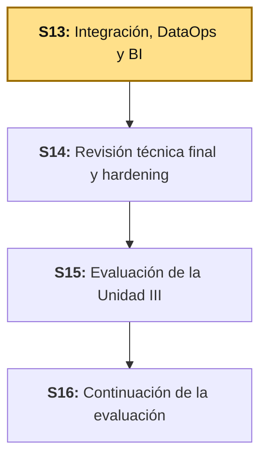
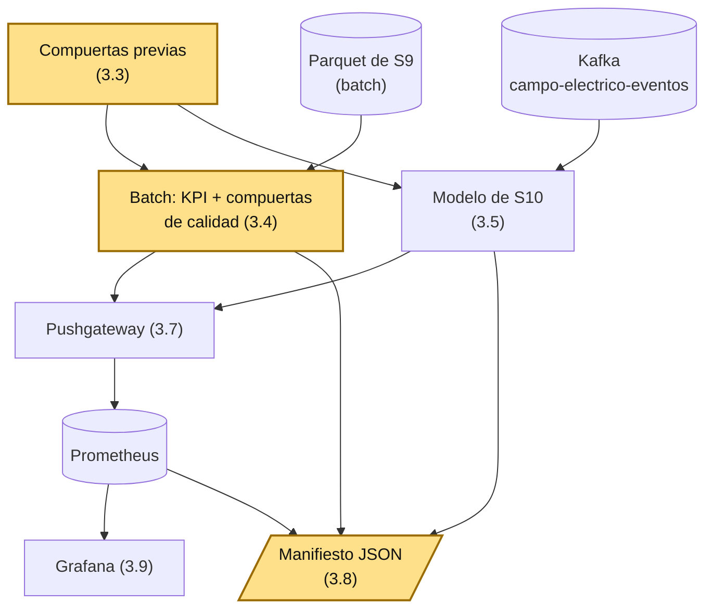

# S13 - Integración del sistema, DataOps y BI

## 1. Introducción

Tiempo: 20 min.

### 1.1 Presentación de la sesión

Entre S6 y S11 el sistema ganó una pieza por sesión: ingesta con Kafka, *streaming* con Spark, observabilidad con Prometheus y Grafana, un modelo de series de tiempo y un tablero de BI. Cada pieza se probó en su propio notebook, se arrancó a mano y se validó mirando la salida. Nunca se ejecutaron **juntas, en una sola corrida, con una forma de saber si esa corrida fue buena**. Esta sesión construye esa corrida: un solo notebook que comprueba sus dependencias antes de empezar, procesa el batch, procesa el *stream* con el modelo, publica los resultados en Prometheus y deja un manifiesto que describe qué pasó. Al preparar la guía, esa corrida encontró algo que los notebooks de S9 y S11 no habían mostrado: un KPI de latencia que pasaba todas las comprobaciones de calidad y, aun así, describía al 45 % de los eventos de forma engañosa (3.4).

### 1.2 Índice

1. DataOps: automatizar y verificar la ejecución de un pipeline de datos.
2. Compuertas previas y compuertas de calidad.
3. Cuando un KPI promedio engaña: percentiles y compuertas de plausibilidad.
4. Integración de batch, *streaming*, modelo y observabilidad en una sola ejecución.
5. El manifiesto de ejecución: qué es reproducible y qué no.

### 1.3 Propósito de aprendizaje

Al concluir la clase, estarás en condiciones de: **integrar** componentes batch y de *streaming* en una ejecución única de punta a punta, **comprobar** dependencias y calidad de datos con compuertas que detienen la ejecución con un mensaje claro, **detectar** un KPI que pasa las comprobaciones y aun así engaña, **publicar** los resultados de una ejecución en Prometheus, y **registrar** cada ejecución en un manifiesto que permita auditarla.

### 1.4 Producto de sesión

Notebook `13_integracion_dataops.ipynb` que, en una sola ejecución: comprueba seis dependencias (los artefactos de S9 y S10, Kafka, Pushgateway, Prometheus y Grafana); calcula sobre el Parquet de S9 los KPI de calidad y de flujo, con compuertas de calidad y de plausibilidad; procesa durante una ventana fija el *stream* real de `campo-electrico-eventos` con el modelo de S10; publica las métricas de la ejecución en Pushgateway y las confirma en Prometheus; y escribe un manifiesto JSON de la ejecución. Más la bitácora de integración con los hallazgos de esta sesión.

### 1.5 Metodología

**Tabla 1. Metodología de la sesión**

| Actividades a Realizar en el Periodo | Orientaciones generales (Orientaciones Metodológicas) | Material de estudio recomendado |
|---|---|---|
| Revisión previa individual | Confirmar que el Parquet de S9 (`atmos_eventos_observabilidad`) y el modelo de S10 (`artifacts/models/modelo_ce_lr`) existen en tu copia: `artifacts/` no se versiona en git, así que cada equipo los genera con su propia corrida. Repasar S9 (Tabla 4, dos tipos de métrica) y S11 (Pushgateway). Trabajo individual, antes de clase. | S9, S10 (3.5), S11 (3.1, 3.4, 3.8). |
| Clase presencial | Construcción guiada del notebook de integración: compuertas previas, batch con compuertas de calidad, *streaming* con el modelo, publicación en Prometheus y manifiesto. Trabajo individual, siguiendo al docente paso a paso. | Stack completo de `lambda26` corriendo (Kafka, PySpark, `obs/` y el productor de `campo-electrico`), pasos 3.1 a 3.10 de esta guía. |
| Evaluación formativa | Revisión en clase de la corrida integrada y del manifiesto, y del hallazgo sobre el KPI de latencia. La evidencia se completa y sustenta de forma individual, fuera del aula, según los criterios mínimos de la sección 4.4. | Indicaciones de entrega (4.3), rúbrica de evaluación (4.6). |

### 1.6 Motivación de la sesión

#### 1.6.1 Caso: el respaldo que "corría" todos los días y estaba vacío (GitLab, 2017)

El 31 de enero de 2017, GitLab.com sufrió una caída mayor: un ingeniero, al intentar reparar la replicación de su base de datos, borró los datos del servidor primario — unos 300 GB — creyendo que trabajaba en el secundario. Al ir a recuperarlos, la compañía descubrió que el informe posterior resume así su situación: "the process of both finding and using backups failed completely". Tenía cuatro mecanismos de protección — copias con `pg_dump`, *snapshots* de LVM, *snapshots* de disco en Azure y replicación — y el *bucket* de S3 donde debían estar las copias de `pg_dump` "was empty": se ejecutaba la versión 9.2 de `pg_dump` contra un PostgreSQL 9.6. Terminaron restaurando desde un *snapshot* de LVM de seis horas antes, y el propio informe nombra la causa de fondo: "nobody was responsible for testing this procedure".

Fuente: GitLab. (2017, 10 de febrero). *Postmortem of database outage of January 31*. https://about.gitlab.com/blog/postmortem-of-database-outage-of-january-31/

El detalle que importa para esta sesión: el trabajo de respaldo **se ejecutaba** — y no devolvía ningún error. Lo que no existía era una comprobación del **resultado**: nadie verificaba que el *bucket* tuviera contenido. Un pipeline de datos que termina sin error no ha demostrado que produjo algo útil. Es el mismo hueco que S13 cierra: comprobar antes de empezar que las dependencias están, y después de cada etapa que lo producido tiene sentido.

**Preguntas de análisis**

**Activación de conocimientos previos**

1. En los notebooks de S9 y S11, ¿cómo supiste que la ejecución había salido bien: porque no hubo errores, o porque comprobaste algún resultado?

**Comprensión del caso**

1. Según el caso, ¿qué comprobación faltaba si el trabajo de respaldo ya terminaba sin error?
2. ¿Por qué una ejecución sin errores no demuestra que el resultado sea correcto?
3. En tu propio pipeline, ¿qué etapa podría terminar "bien" y dejar un resultado vacío o sin sentido sin que nadie se entere?

### 1.7 Ubicación en el curso

- Unidad: U3 - Integración, DataOps y despliegue del sistema final.
- Producto del curso: sistema Big Data distribuido end-to-end para procesamiento batch y streaming, analítica/ML y visualización BI, defendido técnicamente.
- Producto de unidad: sistema Big Data end-to-end, integrado, estabilizado y documentado.
- Avance del producto en esta sesión: una ejecución integrada de batch, *streaming*, modelo y observabilidad, con compuertas de calidad y manifiesto.

**Figura 1. Roadmap del producto de la unidad**



## 2. Explica

Tiempo: 40 min.

### 2.1 Arquitectura de la sesión

**Figura 2. Una ejecución integrada y dónde se comprueba cada cosa**



Lectura del diagrama: ninguna etapa es nueva — el Parquet, el *stream*, el modelo, el Pushgateway y Grafana ya existen desde S9-S11. Lo nuevo son los tres componentes marcados: las compuertas que deciden si la ejecución puede empezar, las que deciden si el batch es confiable, y el manifiesto que deja registro de lo que ocurrió.

### 2.2 DataOps: automatizar y verificar la ejecución de un pipeline

**DataOps** es el conjunto de prácticas que tratan un pipeline de datos como un sistema que se ejecuta, se prueba y se vigila de forma repetible, en lugar de como una secuencia de pasos que alguien lanza a mano y revisa a ojo. Tiene tres rasgos concretos: **dependencias declaradas** (el pipeline sabe qué necesita antes de empezar), **comprobaciones automáticas** (la calidad de los datos se verifica en el propio pipeline, no al final y a mano) y **registro de cada ejecución** (se puede saber después qué corrió, con qué y con qué resultado).

**Tabla 2. Comprobar antes frente a fallar después**

| | Sin compuerta previa | Con compuerta previa |
|---|---|---|
| Una dependencia está caída | El pipeline arranca y falla minutos después, dentro de Spark, con un error largo sobre otra cosa. | Se detiene en el primer segundo con una línea que dice qué dependencia falta. |
| Falta un artefacto de una sesión anterior | Error de ruta en mitad de la ejecución. | La compuerta "el artefacto existe" falla con ese nombre. |
| Quién lo detecta | Quien lee el error, si lo entiende. | El propio pipeline. |

### 2.3 Compuertas previas y compuertas de calidad

Una **compuerta** (*gate*) es una comprobación que, si falla, detiene la ejecución. Hay dos familias, y se distinguen por cuándo corren:

- **Compuertas previas** (*preflight*): corren antes de procesar nada y verifican que las dependencias existen y responden.
- **Compuertas de calidad**: corren sobre los datos ya leídos y verifican que son utilizables.

**Tabla 3. Qué verifica cada tipo de compuerta de calidad**

| Tipo | Pregunta que responde | Ejemplo en esta sesión |
|---|---|---|
| Existencia | ¿Hay datos? | El Parquet tiene filas. |
| Completitud | ¿Faltan valores en las columnas que se van a usar? | `isValid` y `latencyMs` sin nulos. |
| Rango | ¿Los valores caen en el dominio posible? | `ratioValidos` entre 0 y 1. |
| Plausibilidad | ¿El valor típico es creíble para este dominio? | La latencia mediana (p50) es menor a 60 s. |

Las tres primeras son las que casi siempre se escriben. La cuarta es la que cuesta más, porque exige saber **qué valores son creíbles para tu dominio** — y es exactamente la que 3.4 muestra que hacía falta.

### 2.4 Cuando un KPI promedio engaña: percentiles

El **promedio** resume una distribución en un solo número, y ese número solo es representativo cuando los valores se agrupan alrededor de él. Cuando la distribución tiene una "cola" larga o dos grupos distintos, el promedio cae en un punto donde casi no hay datos. Un **percentil** describe la distribución sin ese problema: el **p50** (mediana) es el valor que deja a la mitad de los datos por debajo; el **p95** es el valor que deja al 95 % por debajo, y por tanto muestra cuán mala es la cola.

La regla práctica para métricas de latencia: **nunca publiques solo el promedio**. Publica el p50 (qué experimenta un evento típico) y el p95 (qué tan mal le va a los peores), y calcula además qué fracción supera un umbral que importa en tu dominio.

### 2.5 Un manifiesto de ejecución: qué es reproducible y qué no

Un **manifiesto** es un archivo, escrito al final de cada ejecución, con lo necesario para entenderla después: identificador de la ejecución, versiones del software, resultado de cada compuerta, volúmenes procesados y resultados clave. Permite comparar dos ejecuciones y auditar una.

Un detalle de honestidad: un pipeline con una fuente en vivo **no es reproducible valor por valor**. Dos corridas sobre el mismo *stream* en momentos distintos procesan lecturas distintas y producen un error de predicción distinto. Lo que sí se puede reproducir es el **procedimiento** (los mismos pasos, las mismas compuertas, las mismas dependencias) y lo que sí se puede auditar es **qué dio cada corrida**: para eso existe el manifiesto.

## 3. Aplica: actividad práctica guiada

Tiempo: 2h 30 min.

**Actividad:** construir el notebook `13_integracion_dataops.ipynb`: una ejecución integrada que comprueba sus dependencias, procesa el batch con compuertas de calidad, procesa el *stream* con el modelo de S10, publica sus resultados en Prometheus y deja un manifiesto.

**Propósito de la actividad:** dejar evidencia ejecutable de que puedes ensamblar las piezas de las unidades anteriores en una sola ejecución verificable, y de que sabes detectar un resultado que "se ve bien" y no lo es.

**Orientaciones metodológicas:** en clase, el docente construye el notebook celda por celda; los estudiantes replican cada una sobre su propia evidencia de S9/S10. Si algún equipo no completó S9 o S10, la compuerta de 3.3 se lo indica con el nombre exacto del artefacto que falta, y avanza con lo que sí tenga.

**Actividades para realizar:**

- **3.1** Reanudar el entorno completo.
- **3.2** Crear el notebook y la sesión de Spark.
- **3.3** Compuertas previas.
- **3.4** Batch: KPI con compuertas de calidad y de plausibilidad.
- **3.5** *Streaming*: el modelo de S10 sobre Kafka, en una ventana fija.
- **3.6** Error de predicción en producción.
- **3.7** Publicar en Pushgateway y confirmar en Prometheus.
- **3.8** Escribir el manifiesto.
- **3.9** Tablero de integración en Grafana.
- **3.10** Registrar los hallazgos en la bitácora.

### 3.1 Reanudar el entorno completo

**Producto del paso:** los cuatro grupos de contenedores de `lambda26` arriba y el productor de eventos publicando.

Desde la raíz del repositorio, en este orden (Kafka primero, porque `obs/` y `pyspark` se unen a su red):

```powershell
docker compose -f kafka/compose.yml up -d
docker compose -f pyspark/compose.yml -f pyspark/compose.kafka.yml up -d
docker compose -f obs/compose.yml up -d
docker compose -f uso-campo-electrico/compose.yml up -d
```

Y, en una terminal aparte que dejes abierta, el productor (el contenedor arranca en `sleep infinity`; el productor lo lanzas tú):

```powershell
docker exec -it lambda26-uso-campo-electrico python producer_campo_electrico.py
```

Confirma que publica leyendo dos mensajes del topic:

```powershell
docker exec lambda26-kafka /opt/kafka/bin/kafka-console-consumer.sh --bootstrap-server localhost:9092 --topic campo-electrico-eventos --from-beginning --max-messages 2
```

Resultado real de esta sesión: dos JSON con `tipoEvento: estacion.lectura`, `estacionId: estacion-ns-01` y las lecturas de `CE`, `TempOut`, `Bar`, etcétera.

**Error frecuente**: lanzar los comandos de `docker exec` desde Git Bash en Windows con una ruta absoluta (`/opt/kafka/...`): Git Bash la convierte en una ruta de Windows y el comando falla con `no such file or directory`. Usa PowerShell, o antepón `MSYS_NO_PATHCONV=1` en Git Bash.

### 3.2 Crear el notebook y la sesión de Spark

**Producto del paso:** `pyspark/sesiones/s13-integracion-dataops/13_integracion_dataops.ipynb` con la sesión de Spark lista, y la carpeta `artifacts/` para el manifiesto.

Crea la carpeta `s13-integracion-dataops/` dentro de `pyspark/sesiones/` (la única que se monta en el contenedor) y, en JupyterLab (`http://localhost:4488/lab?token=sintoken`), un notebook nuevo con esta primera celda — la misma configuración de S11:

```python
from pyspark.sql import SparkSession
from pyspark.sql import functions as F

spark = (
    SparkSession.builder
    .appName("sesion13-integracion-dataops")
    .master("local[*]")
    .config("spark.jars.packages", "org.apache.spark:spark-sql-kafka-0-10_2.13:4.2.0")
    .config("spark.sql.shuffle.partitions", "8")
    .getOrCreate()
)
spark.sparkContext.setLogLevel("ERROR")
spark
```

### 3.3 Compuertas previas

**Producto del paso:** una celda que comprueba seis dependencias y detiene la ejecución si alguna falla.

```python
import json, os, platform, time, urllib.request
from datetime import datetime, timezone

RUN_ID = datetime.now(timezone.utc).strftime("%Y%m%dT%H%M%SZ")
INICIO = time.time()
manifiesto = {"runId": RUN_ID, "sparkVersion": spark.version, "python": platform.python_version(),
              "compuertas": {}, "batch": {}, "streaming": {}, "observabilidad": {}}

RUTA_EVENTOS_S9 = "../s09-observabilidad-pipeline/artifacts/atmos_eventos_observabilidad"
RUTA_MODELO_S10 = "../s10-series-tiempo-inferencia-streaming/artifacts/models/modelo_ce_lr"
TOPIC = "campo-electrico-eventos"

def http_ok(url):
    try:
        with urllib.request.urlopen(url, timeout=5) as r:
            return r.status == 200
    except Exception:
        return False

def kafka_filas(topic):
    return (spark.read.format("kafka")
            .option("kafka.bootstrap.servers", "kafka:9092")
            .option("subscribe", topic)
            .option("startingOffsets", "earliest").option("endingOffsets", "latest")
            .load().count())

compuertas = {
    "Parquet de S9 existe": os.path.isdir(RUTA_EVENTOS_S9),
    "Modelo de S10 existe": os.path.isdir(RUTA_MODELO_S10),
    "Pushgateway listo": http_ok("http://pushgateway:9091/-/ready"),
    "Prometheus listo": http_ok("http://prometheus:9090/-/ready"),
    "Grafana saludable": http_ok("http://grafana:3000/api/health"),
}
try:
    filas_topic = kafka_filas(TOPIC)
    compuertas["Kafka: topic " + TOPIC + " con datos"] = filas_topic > 0
except Exception as e:
    filas_topic = 0
    compuertas["Kafka: topic " + TOPIC + " con datos"] = False

for nombre, ok in compuertas.items():
    print(("OK    " if ok else "FALLA ") + nombre)
manifiesto["compuertas"] = compuertas
manifiesto["kafkaFilasTopic"] = filas_topic
fallidas = [n for n, ok in compuertas.items() if not ok]
assert not fallidas, "Compuertas que fallan: " + str(fallidas)
```

Resultado real de esta sesión:

```text
OK    Parquet de S9 existe
OK    Modelo de S10 existe
OK    Pushgateway listo
OK    Prometheus listo
OK    Grafana saludable
OK    Kafka: topic campo-electrico-eventos con datos
```

Los nombres de host (`pushgateway`, `prometheus`, `grafana`, `kafka`) son los de la red Docker `lambda26-kafka-net`, a la que el contenedor de PySpark ya está unido (S11, 3.1). Para ver la compuerta actuar, detén uno de los servicios (`docker stop lambda26-pushgateway`) y vuelve a ejecutar la celda: el `assert` se detiene en el acto con `Compuertas que fallan: ['Pushgateway listo']`, en vez de dejar que Spark falle más adelante. Vuelve a levantarlo antes de seguir (`docker start lambda26-pushgateway`).

**Error frecuente**: que "Parquet de S9 existe" o "Modelo de S10 existe" falle en una copia recién clonada. `pyspark/sesiones/*/artifacts/` está en el `.gitignore` del repositorio: esos artefactos no viajan con `git clone`, se generan ejecutando S9 y S10. La compuerta existe justamente para decírtelo con ese nombre.

### 3.4 Batch: KPI con compuertas de calidad y de plausibilidad

**Producto del paso:** los KPI del Parquet de S9 calculados con percentiles de latencia, y las compuertas de calidad aplicadas.

```python
eventos = spark.read.parquet(RUTA_EVENTOS_S9)
total = eventos.count()
nulos = eventos.select(
    F.sum(F.col("isValid").isNull().cast("int")).alias("isValid"),
    F.sum(F.col("latencyMs").isNull().cast("int")).alias("latencyMs"),
).first()

kpi = eventos.agg(
    F.avg(F.col("isValid").cast("int")).alias("ratioValidos"),
    F.avg("latencyMs").alias("latenciaPromedioMs"),
    F.expr("percentile_approx(latencyMs, 0.5)").alias("latenciaP50Ms"),
    F.expr("percentile_approx(latencyMs, 0.95)").alias("latenciaP95Ms"),
    F.max("latencyMs").alias("latenciaMaxMs"),
    F.avg((F.col("latencyMs") > 60000).cast("int")).alias("fraccionMayor1Min"),
).first()

compuertas_calidad = {
    "Hay filas": total > 0,
    "isValid sin nulos": (nulos["isValid"] or 0) == 0,
    "latencyMs sin nulos": (nulos["latencyMs"] or 0) == 0,
    "ratioValidos en [0, 1]": 0.0 <= kpi["ratioValidos"] <= 1.0,
    "Latencia tipica (p50) menor a 60 s": kpi["latenciaP50Ms"] < 60000,
}
for nombre, ok in compuertas_calidad.items():
    print(("OK    " if ok else "FALLA ") + nombre)
assert all(compuertas_calidad.values()), "La calidad del batch no pasa"

print(f"Eventos: {total:,}  |  ratio de validos: {kpi['ratioValidos']:.4f}")
print(f"Latencia: promedio {kpi['latenciaPromedioMs']:.0f} ms | p50 {kpi['latenciaP50Ms']} ms | p95 {kpi['latenciaP95Ms']} ms | max {kpi['latenciaMaxMs']} ms")
print(f"Eventos con mas de 1 minuto de latencia: {kpi['fraccionMayor1Min']:.1%}")
advertencias = []
if kpi["latenciaP95Ms"] > 300000:
    advertencias.append("p95 de latencia mayor a 5 minutos: el promedio no representa a la mayoria de los eventos")
for a in advertencias:
    print("ADVERTENCIA:", a)
manifiesto["batch"] = {"filas": total, "ratioValidos": kpi["ratioValidos"], "latenciaPromedioMs": kpi["latenciaPromedioMs"],
                       "latenciaP50Ms": kpi["latenciaP50Ms"], "latenciaP95Ms": kpi["latenciaP95Ms"],
                       "latenciaMaxMs": kpi["latenciaMaxMs"], "fraccionMayor1Min": kpi["fraccionMayor1Min"],
                       "calidad": compuertas_calidad, "advertencias": advertencias}
```

Resultado real de esta sesión:

```text
OK    Hay filas
OK    isValid sin nulos
OK    latencyMs sin nulos
OK    ratioValidos en [0, 1]
OK    Latencia tipica (p50) menor a 60 s
Eventos: 1,866  |  ratio de validos: 1.0000
Latencia: promedio 398793 ms | p50 11491 ms | p95 1488930 ms | max 1582393 ms
Eventos con mas de 1 minuto de latencia: 45.3%
ADVERTENCIA: p95 de latencia mayor a 5 minutos: el promedio no representa a la mayoria de los eventos
```

Este es el hallazgo central de la sesión. El KPI de latencia que S11 publicó —el promedio— valía **398 793 ms, unos 6,6 minutos**, y ninguna comprobación de nulos o de rango lo habría puesto en duda. Pero la distribución dice otra cosa: la mediana es de **11,5 segundos**, y el p95 es de **1 489 segundos (casi 25 minutos)**. El 45,3 % de los eventos esperó más de un minuto. El promedio de 6,6 minutos no describe a ningún grupo: ni al evento típico (11,5 s) ni a los lentos (hasta ~26 minutos). La distribución es de dos grupos, y un promedio publicado solo, en un tablero, sugiere un sistema con una latencia estable de 6,6 minutos que no existe.

Qué lo causa no lo comprueba esta guía; el patrón es consistente con eventos que esperaron en el topic antes de que S9 los procesara (la latencia de S9 es `processedAt - timestamp`, y `timestamp` lo pone el sensor), pero confirmarlo exigiría reconstruir la corrida de S9. Lo que sí queda establecido es la conclusión práctica: **publica percentiles, no solo el promedio**, y agrega una compuerta de plausibilidad. La compuerta de esta celda usa la mediana (que pasa) y deja el p95 como **advertencia**, no como falla: un p95 alto es una señal que el equipo debe mirar, pero detener todo el pipeline por ello sería una decisión de negocio, no técnica.

**Error frecuente**: poner la compuerta de plausibilidad sobre el promedio. Aquí el promedio (398 s) habría fallado cualquier umbral razonable y detenido el pipeline por un valor que no representa a nadie; el p50 es el que mide lo que experimenta un evento típico.

### 3.5 *Streaming*: el modelo de S10 sobre Kafka, en una ventana fija

**Producto del paso:** el modelo de S10 aplicado al *stream* real durante 45 segundos, con las filas procesadas acumuladas en memoria.

```python
from pyspark.ml import PipelineModel
from pyspark.sql.types import StructType, StringType, DoubleType, LongType

modelo = PipelineModel.load(RUTA_MODELO_S10)
esquema_evento = (
    StructType().add("tipoEvento", StringType()).add("estacionId", StringType())
    .add("CE", DoubleType()).add("CM", DoubleType()).add("TempOut", DoubleType())
    .add("OutHum", DoubleType()).add("WindSpeed", DoubleType()).add("Bar", DoubleType())
    .add("SolarRad", DoubleType()).add("UVIndex", DoubleType())
    .add("origen", StringType()).add("timestamp", LongType())
)
crudo = (spark.readStream.format("kafka")
         .option("kafka.bootstrap.servers", "kafka:9092").option("subscribe", TOPIC)
         .option("startingOffsets", "latest").option("failOnDataLoss", "false").load())
eventos_stream = (crudo.select(F.from_json(F.col("value").cast("string"), esquema_evento).alias("e")).select("e.*"))
predicciones = modelo.transform(eventos_stream)

acumulado = []
microlotes = []

def procesar_microlote(df, id_lote):
    filas = df.select("estacionId", "timestamp", "CE", "prediction").collect()
    microlotes.append({"batchId": id_lote, "filas": len(filas)})
    acumulado.extend((f["estacionId"], f["timestamp"], f["CE"], f["prediction"]) for f in filas)

DURACION_S = 45
consulta = predicciones.writeStream.foreachBatch(procesar_microlote).start()
consulta.awaitTermination(DURACION_S)
consulta.stop()

print("Micro-lotes con datos:", len([m for m in microlotes if m["filas"] > 0]))
print("Filas procesadas en", DURACION_S, "s:", len(acumulado))
```

Resultado real de esta sesión: 15 micro-lotes con datos y 15 filas procesadas en 45 segundos. A diferencia de S11 (que dejaba la consulta corriendo indefinidamente), `awaitTermination(DURACION_S)` seguido de `stop()` la acota en el tiempo: una ejecución integrada tiene que **terminar** para poder comprobarse y registrarse. `startingOffsets` queda en `latest`, así que solo cuenta lo que publica el productor mientras la ventana está abierta: por eso el productor de 3.1 tiene que estar corriendo.

**Error frecuente**: el `assert` de la celda siguiente (3.6) falla con `El stream no entrego ninguna fila: esta corriendo el productor?`. Casi siempre es que el productor de 3.1 se detuvo (cerrar su terminal lo apaga).

### 3.6 Error de predicción en producción

**Producto del paso:** el error absoluto medio (MAE) del modelo frente a la lectura real siguiente, calculado sobre lo que acaba de procesar el *stream*.

```python
# MAE de produccion: la prediccion de una lectura contra el CE real de la lectura siguiente de la misma estacion
por_estacion = {}
for estacion, ts, ce, pred in sorted(acumulado, key=lambda x: (x[0], x[1])):
    por_estacion.setdefault(estacion, []).append((ce, pred))

errores = []
for lecturas in por_estacion.values():
    for (ce_actual, pred_actual), (ce_siguiente, _) in zip(lecturas, lecturas[1:]):
        errores.append(abs(pred_actual - ce_siguiente))

mae = sum(errores) / len(errores) if errores else None
print("Pares comparables:", len(errores), " | MAE en produccion:", None if mae is None else round(mae, 4))
assert acumulado, "El stream no entrego ninguna fila: esta corriendo el productor?"
manifiesto["streaming"] = {"duracionS": DURACION_S, "filas": len(acumulado), "microlotes": microlotes,
                           "paresComparables": len(errores), "maeProduccion": mae}
```

Resultado real de esta sesión, en dos corridas distintas: 14 pares comparables y un MAE de **0,0330** en la primera, **0,0426** en la segunda. Los dos valores son distintos porque cada corrida procesó lecturas distintas de un *stream* en vivo (2.5): es el comportamiento esperado, no un defecto, y es exactamente lo que el manifiesto de 3.8 deja registrado para poder compararlas.

### 3.7 Publicar en Pushgateway y confirmar en Prometheus

**Producto del paso:** las métricas de la ejecución en Prometheus, confirmadas con una consulta.

```python
metricas = {
    "lambda26_int_batch_eventos_total": manifiesto["batch"]["filas"],
    "lambda26_int_batch_validos_ratio": manifiesto["batch"]["ratioValidos"],
    "lambda26_int_batch_latencia_p50_ms": manifiesto["batch"]["latenciaP50Ms"],
    "lambda26_int_batch_latencia_p95_ms": manifiesto["batch"]["latenciaP95Ms"],
    "lambda26_int_stream_filas_total": manifiesto["streaming"]["filas"],
    "lambda26_int_stream_mae": mae if mae is not None else 0,
    "lambda26_int_ultima_ejecucion_timestamp": int(time.time()),
}
cuerpo = "".join("# TYPE " + n + " gauge\n" + n + " " + str(v) + "\n" for n, v in metricas.items())
url = "http://pushgateway:9091/metrics/job/lambda26_integracion/instance/s13"
with urllib.request.urlopen(urllib.request.Request(url, data=cuerpo.encode(), method="PUT")) as r:
    print("Pushgateway respondio:", r.status)

def consultar(nombre):
    resultado = json.load(urllib.request.urlopen("http://prometheus:9090/api/v1/query?query=" + nombre))["data"]["result"]
    return resultado[0]["value"][1] if resultado else None

def coincide(obtenido, esperado):
    return obtenido is not None and abs(float(obtenido) - float(esperado)) <= 1e-6 * max(1.0, abs(float(esperado)))

confirmadas = {}
limite = time.time() + 90
while time.time() < limite:
    confirmadas = {n: consultar(n) for n in metricas}
    if all(coincide(confirmadas[n], v) for n, v in metricas.items()):
        break
    time.sleep(5)
for n, v in metricas.items():
    print(n + ":", confirmadas[n], "(publicado:", v, ")")
todas = all(coincide(confirmadas[n], v) for n, v in metricas.items())
manifiesto["observabilidad"] = {"metricas": confirmadas, "todasEnPrometheus": todas}
assert todas, "Prometheus no devolvio los valores recien publicados"
```

Resultado real de esta sesión: `Pushgateway respondio: 200` y las siete métricas devueltas por Prometheus (entre ellas `lambda26_int_batch_latencia_p50_ms: 11491` y `lambda26_int_batch_latencia_p95_ms: 1488930`). El bucle de espera existe porque Prometheus no recibe el dato en el instante del `PUT`: el Pushgateway lo guarda y Prometheus lo recoge en su siguiente *scrape*; la celda espera hasta 90 segundos en lugar de asumirlo. Y compara cada valor devuelto con el que **acabas de publicar**, no solo con que exista: una versión anterior de esta celda se daba por satisfecha en cuanto cada métrica tenía *algún* valor, y en una segunda corrida validó los de la corrida anterior (devolvió el MAE y la marca de tiempo de la ejecución previa mientras la actual había calculado otro MAE). Con esta celda, las compuertas de 3.3 y 3.4 y la confirmación final cubren el principio y el final de la ejecución.

**Error frecuente**: confirmar una publicación comprobando solo que "hay un valor". Si la métrica ya existía de una corrida anterior, esa comprobación pasa sin que tu publicación nueva haya llegado.

### 3.8 Escribir el manifiesto

**Producto del paso:** un archivo `artifacts/manifiesto_<runId>.json` con el registro de la ejecución.

```python
manifiesto["duracionTotalS"] = round(time.time() - INICIO, 1)
ruta_manifiesto = "./artifacts/manifiesto_" + RUN_ID + ".json"
with open(ruta_manifiesto, "w", encoding="utf-8") as f:
    json.dump(manifiesto, f, indent=2, ensure_ascii=False, default=str)
print("Manifiesto escrito en", ruta_manifiesto)
print(json.dumps({k: manifiesto[k] for k in ("runId", "sparkVersion", "duracionTotalS")}, indent=2))
```

Resultado real de esta sesión: `manifiesto_20261106T031314Z.json`, con `sparkVersion: 4.2.0`. La primera corrida tardó 76,8 s y la segunda 304,5 s: la diferencia está en lo que cada una esperó (el bucle de 3.7 hasta que Prometheus recogió las métricas, y la carga de la laptop), no en un cambio del código — otra razón para registrar la duración en el manifiesto en vez de recordarla. El manifiesto guarda el resultado de cada compuerta, los percentiles, el MAE y los micro-lotes; abre el JSON y confirma que están todos.

`artifacts/` está en el `.gitignore` de `pyspark/`, así que el manifiesto no se versiona: es evidencia de **tu** corrida, y la guarda tu equipo para la sustentación.

### 3.9 Tablero de integración en Grafana

**Producto del paso:** un tablero con los resultados de la última ejecución integrada.

En Grafana (`http://localhost:43000`, `admin`/`admin`, *datasource* Prometheus), crea un tablero nuevo con estos paneles. Las consultas son las métricas que 3.7 acaba de dejar en Prometheus:

**Tabla 4. Paneles del tablero de integración**

| Panel | Tipo | Consulta PromQL | Qué responde |
|---|---|---|---|
| Latencia: p50 frente a p95 | Estadística (dos valores) | `lambda26_int_batch_latencia_p50_ms` y `lambda26_int_batch_latencia_p95_ms` | ¿Qué experimenta un evento típico y qué tan mal le va a los peores? |
| Ratio de eventos válidos | Medidor | `lambda26_int_batch_validos_ratio` | ¿Qué fracción de lo procesado es utilizable? |
| Error del modelo en producción | Estadística | `lambda26_int_stream_mae` | ¿Cuánto se equivoca el modelo frente a la realidad? |
| Antigüedad de la última ejecución | Estadística | `time() - lambda26_int_ultima_ejecucion_timestamp` | ¿Cuándo corrió por última vez la ejecución integrada? |

El cuarto panel es el que convierte al tablero en parte de DataOps: sin él, una ejecución que dejó de correr hace tres días deja un tablero que sigue mostrando los valores de esa última vez, con apariencia de estar vivo. Esta guía verificó las cuatro métricas en Prometheus (3.7); la construcción de los paneles en Grafana es parte de tu evidencia.

**Error frecuente**: dejar el panel de latencia mostrando solo el promedio, ya que `lambda26_bi_latencia_promedio_ms` (de S11) sigue publicado en el Pushgateway. Reemplázalo por p50 y p95 — es la corrección de 3.4 llevada al tablero.

### 3.10 Registrar los hallazgos en la bitácora

**Producto del paso:** la bitácora de integración de esta sesión, una fila por hallazgo.

**Tabla 5. Bitácora de integración**

| # | Hallazgo | Causa | Corrección | Prueba de corrección |
|---|---|---|---|---|
| 1 | El KPI de latencia promedio (S11) valía 6,6 minutos y describía solo a una minoría. | Se publicaba el promedio de una distribución de dos grupos; las compuertas de nulos y rango no lo detectan. | Percentiles p50 y p95, fracción mayor a 1 minuto, compuerta de plausibilidad sobre el p50 y advertencia sobre el p95 (3.4). | La celda de 3.4 imprime p50 = 11 491 ms y p95 = 1 488 930 ms junto al promedio, y la advertencia. |
| 2 | Una copia clonada del repositorio no puede ejecutar la integración: faltan los artefactos de S9 y S10. | `artifacts/` está en el `.gitignore`: no viaja con `git clone`. | Compuertas previas que nombran el artefacto que falta (3.3). | Con el Parquet o el modelo ausente, la celda de 3.3 se detiene con `Compuertas que fallan: ['Parquet de S9 existe']`. |

**Evidencia de aprendizaje:**

- Entorno completo de `lambda26` levantado y productor publicando (3.1).
- Compuertas previas con sus seis resultados, y la prueba de una compuerta fallando (3.3).
- KPI del batch con percentiles y compuertas de calidad y de plausibilidad (3.4).
- *Stream* procesado con el modelo en una ventana fija, y MAE de producción (3.5-3.6).
- Las siete métricas confirmadas en Prometheus (3.7).
- Manifiesto de la ejecución (3.8) y tablero de integración (3.9).
- Bitácora de integración con la prueba de cada corrección (3.10).

## 4. Crea: actividad autónoma

Tiempo: 2h 30 min fuera del aula.

### 4.1 Actividad

Integración y documentación del sistema del **Proyecto Sello** propio del equipo.

Completa y evidencia estas tareas:

1. Construye una ejecución integrada de tu propio pipeline —que combine tu componente batch y tu componente de *streaming*— con al menos **cuatro compuertas previas** sobre tus propias dependencias.
2. Calcula al menos un KPI de latencia o de tiempo de tu propio dominio con **percentiles (p50 y p95)**, no solo con promedio, y agrega una compuerta de plausibilidad con un umbral que justifiques para tu dominio.
3. Ejecuta tu pipeline de punta a punta una vez y publica sus resultados en Prometheus, confirmándolos con una consulta.
4. Escribe el manifiesto de esa ejecución, y compara el de dos corridas distintas: qué cambió y por qué.
5. Documenta tu sistema: el **flujo completo** (diagrama), sus **dependencias** (tabla: qué necesita cada componente), los **pasos de ejecución** (en el orden exacto en que los ejecutaste) y las **evidencias de integración** (la corrida, el manifiesto, la consulta de Prometheus).

### 4.2 Propósito

Que cada estudiante demuestre, de forma individual y fuera del aula, que puede integrar los componentes de su propio sistema Big Data en una ejecución verificable, y que su documentación basta para que otra persona la repita.

### 4.3 Indicaciones

Entrega un PDF con el siguiente nombre:

```text
S13_Equipo##_ApellidoNombre.pdf
```

Cada captura de pantalla del informe debe mostrar, sin recortar, el reloj del sistema (fecha y hora) y tu usuario o foto de perfil (Windows, VS Code o navegador) visibles en pantalla — es lo que permite verificar que la evidencia es tuya y que corresponde al momento real de tu trabajo.

#### 4.3.1 Estructura del informe

**Datos del estudiante**

- Nombre:
- Equipo:
- Sesión: S13 - Integración del sistema, DataOps y BI
- Rol o aporte realizado:
- Link de GitHub:

**Evidencia técnica**

Incluye capturas o extractos con una breve explicación debajo de cada uno, organizados en los mismos 4 bloques de la rúbrica (4.6):

1. *Compuertas previas y de calidad*
    - Los resultados de tus compuertas previas y de calidad, y una compuerta fallando a propósito para demostrar que detiene la ejecución.
2. *Integración de punta a punta*
    - La ejecución integrada de tu pipeline (batch, *streaming* y publicación en Prometheus), con la consulta que confirma las métricas.
3. *Manifiesto de ejecución*
    - El manifiesto de al menos dos corridas, y la comparación de qué cambió entre ellas.
4. *Documentación del sistema*
    - El diagrama del flujo completo, la tabla de dependencias, los pasos de ejecución y las evidencias de integración.

**Error o hallazgo**

Describe un error real: una compuerta que falló y por qué, un KPI de tu propio dominio cuyo promedio no representaba a la mayoría de los datos, un artefacto de una sesión anterior que no estaba en tu copia, o cualquier otro obstáculo real de esta sesión.

**Reflexión técnica breve**

Responde en 5 a 8 líneas:

```text
Relaciona el caso de GitLab (1.6) con tu propio pipeline: ¿qué etapa
tuya podría terminar sin error y dejar un resultado vacío o sin sentido,
qué compuerta lo detectaría, y por qué no bastaba con que la ejecución
terminara bien?
```

**Anexo: Feedback de la sesión**

Pega esta página como la última hoja del PDF, con tus respuestas.

1. ¿Cuál es el aprendizaje más importante que te llevas de la clase de hoy?
2. ¿Qué punto de la clase te resultó más confuso o te dejó con dudas?
3. ¿Tienes alguna pregunta que te gustaría que sea respondida la siguiente clase?
4. Sobre tu nivel de comprensión de la clase de hoy, marca una opción:
    - ¡Entendido! - Lo domino y podría explicarlo.
    - Más o menos. - Entendí la idea general, pero tengo dudas.
    - Necesito ayuda. - Me siento perdido/a con este tema.
5. ¿Cómo puedo ayudarte a comprender mejor el tema?
6. Pensando en tu participación y esfuerzo en la clase de hoy, ¿cómo te autoevaluarías? Marca una opción:
    - Muy Comprometido/a: Me esforcé al máximo.
    - Comprometido/a: Sé que podría haberme esforzado un poco más.
    - Poco Comprometido/a: Hoy no di mi mejor esfuerzo.
7. Mi satisfacción con la clase fue... (califica del 1 al 10, donde 1 es insatisfecho y 10 es muy satisfecho).

### 4.4 Criterios mínimos de aceptación

- El archivo respeta el nombre solicitado.
- Al menos cuatro compuertas previas sobre dependencias propias, con una demostrada fallando.
- Al menos un KPI de tiempo con percentiles (p50 y p95) y una compuerta de plausibilidad con umbral justificado.
- Ejecución de punta a punta de un pipeline propio con componente batch y de *streaming*, con resultados confirmados en Prometheus.
- Manifiesto de al menos dos corridas, con la comparación entre ellas.
- Documentación con flujo completo, dependencias, pasos de ejecución y evidencias de integración.
- Cada captura de la evidencia técnica muestra el reloj del sistema y el usuario/perfil visible, sin recortar.
- Las fechas y horas de las capturas son coherentes con el historial de commits de su repositorio en GitHub.
- Incluye un error o hallazgo técnico diagnosticado.
- Incluye la reflexión técnica breve solicitada.
- Incluye el Anexo de feedback de la sesión respondido, como última página del PDF.

### 4.5 Preguntas de defensa

1. ¿Qué diferencia hay entre una compuerta previa y una compuerta de calidad, y por qué conviene que la primera corra antes de que Spark lea nada?
2. ¿Por qué una ejecución que termina sin error no demuestra que el resultado sea correcto? Relaciónalo con el caso de GitLab.
3. En tu KPI de tiempo, ¿qué mostró el p95 que el promedio ocultaba, y qué decisión tomaste al respecto?
4. ¿Por qué la compuerta de plausibilidad usa el p50 y el p95 queda como advertencia, y no al revés?
5. Tus dos manifiestos dieron valores distintos de error del modelo: ¿es un defecto o es esperable, y qué parte de la ejecución sí es reproducible?
6. ¿Para qué sirve el panel "antigüedad de la última ejecución" en un tablero alimentado por un Pushgateway?
7. Si otra persona clonara tu repositorio hoy, ¿qué compuerta le diría primero qué le falta, y por qué?

### 4.6 Rúbrica de evaluación

**Tabla 6. Rúbrica de evaluación**

| Criterio | Peso (%) | A (20 pts) | B (15 pts) | C (10 pts) | D (5 pts) | Nivel obtenido |
|---|---:|---|---|---|---|---:|
| 1. Compuertas previas y de calidad* | 25 | Al menos cuatro compuertas previas y compuertas de calidad con una de plausibilidad sobre percentiles, con una demostrada fallando. | Compuertas presentes, con la de plausibilidad o la demostración de fallo ausente. | Solo compuertas previas, o solo de calidad. | No presenta compuertas. | |
| 2. Integración de punta a punta* | 25 | Pipeline propio con batch y *streaming* ejecutado de punta a punta, con resultados confirmados en Prometheus. | Ejecutado, con la confirmación en Prometheus incompleta. | Componentes ejecutados por separado, sin integrar. | No presenta ejecución integrada. | |
| 3. Manifiesto de ejecución* | 25 | Manifiesto de al menos dos corridas con la comparación entre ellas explicada. | Manifiesto de una corrida, o dos sin comparar. | Registro parcial de la ejecución. | No presenta manifiesto. | |
| 4. Documentación del sistema* | 25 | Flujo completo, dependencias, pasos de ejecución y evidencias, suficientes para que otra persona repita la corrida. | Documentación completa, con algún paso que requiere aclaración. | Documentación parcial. | No presenta documentación. | |

\* Agregado manual.

Nota final = suma de (`Peso` / 100 × `Puntos del nivel obtenido`) = ____ / 20.

Para usar la rúbrica con IA, solicita:

```text
Evalúa el PDF usando la rúbrica de la sesión.
Para cada criterio selecciona el nivel obtenido usando la escala A=20, B=15, C=10, D=5 puntos.
Justifica brevemente cada nivel asignado.
Verifica que cada captura muestre reloj del sistema y usuario/perfil visible, y que las fechas sean coherentes con el historial de commits de GitHub. Si falta esta evidencia o hay inconsistencias, indícalo explícitamente antes de calificar.
Calcula la nota final con la fórmula: suma de (Peso/100 × Puntos del nivel obtenido), directamente sobre 20.
Indica 2 fortalezas y 2 recomendaciones.
```

## 5. Cierre

Tiempo: 5 min.

**Resumen breve:** hoy las piezas de S6 a S11 dejaron de ser seis notebooks sueltos y pasaron a ser una sola ejecución que sabe si puede empezar, sabe si lo que procesa es utilizable, publica lo que encontró y deja registro de lo que hizo. Esa ejecución integrada mostró algo que ningún notebook anterior había mostrado: un KPI de latencia de 6,6 minutos que pasaba todas las comprobaciones de calidad y, sin embargo, no describía a ningún grupo real de eventos — la mediana era de 11,5 segundos y el p95 de casi 25 minutos. El caso de GitLab lo resume: un proceso que termina sin error no ha demostrado que produjo algo útil.

**Dinámica participativa:** en una ronda rápida, cada estudiante comparte en una frase qué compuerta de su propio pipeline habría detectado un problema que hoy solo se vería leyendo la salida a ojo.

**Metacognición:** ¿qué te costó más entender hoy: por qué un promedio puede ser un número que no representa a ningún dato, o por qué una compuerta de plausibilidad exige conocer el dominio y no solo los tipos de columna?

**Proyección:** S14 hace la revisión técnica final y el *hardening* del sistema: estabilizar la configuración, corregir fallos y completar el checklist y el guion de la demostración — con la ejecución integrada de hoy como la prueba de que todo sigue funcionando después de cada cambio.

## Bibliografía

1. GitLab. (2017, 10 de febrero). *Postmortem of database outage of January 31*. https://about.gitlab.com/blog/postmortem-of-database-outage-of-january-31/
