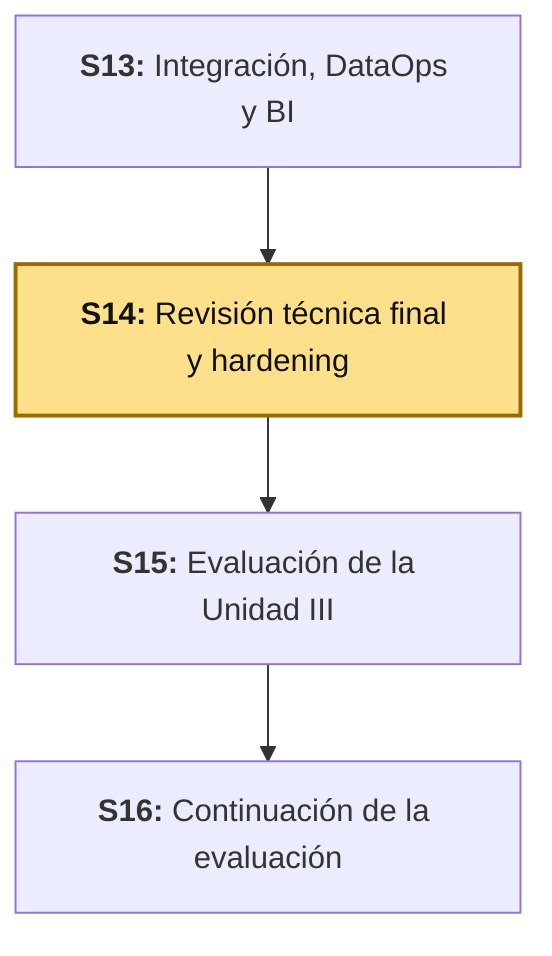
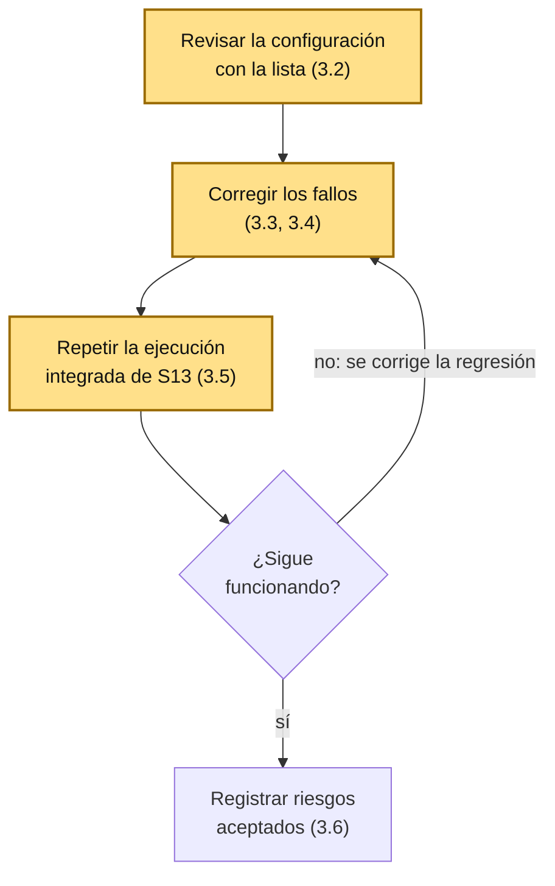

# S14 - Revisión técnica final y hardening

## 1. Introducción

Tiempo: 20 min.

### 1.1 Presentación de la sesión

S13 dejó una ejecución integrada que recorre batch, *streaming*, modelo y observabilidad. Pero el sistema donde corre esa ejecución —los contenedores de Kafka, Prometheus, Grafana y Spark— se levantó en S6-S11 con la configuración mínima para que funcionara en clase, y nadie la revisó como un conjunto. Esta sesión hace esa revisión: recorre la configuración real de `lambda26` con una lista de comprobación, corrige lo que falla, y vuelve a ejecutar la integración de S13 para demostrar que los cambios no rompieron nada. La revisión encontró tres hallazgos reales, y uno de ellos estaba en la propia comprobación de S13 (3.5).

### 1.2 Índice

1. Qué es el *hardening* y qué es una revisión técnica.
2. Comprobar que un servicio está listo, no solo que arrancó.
3. Configuración sin secretos escritos en el código.
4. Prueba de no regresión: cambiar sin romper.
5. Riesgos aceptados frente a riesgos corregidos.

### 1.3 Propósito de aprendizaje

Al concluir la clase, estarás en condiciones de: **revisar** la configuración de un sistema distribuido contra una lista de comprobación, **corregir** los fallos de configuración que encuentres, **demostrar** con una ejecución integrada que un cambio no introdujo una regresión, **distinguir** un riesgo que se corrige de uno que se acepta con justificación, y **preparar** la demostración y la explicación técnica del sistema con evidencia y métricas reales.

### 1.4 Producto de sesión

La configuración de `lambda26` revisada con la lista de comprobación de 3.2, con los fallos corregidos (comprobaciones de salud en `kafka/` y `obs/`, credenciales de Grafana parametrizadas); la ejecución integrada de S13 repetida como prueba de no regresión, con el defecto que esa repetición encontró corregido; la tabla de riesgos aceptados; el guion de la demostración; y la explicación técnica del sistema con sus decisiones y lo que cada una cuesta.

### 1.5 Metodología

**Tabla 1. Metodología de la sesión**

| Actividades a Realizar en el Periodo | Orientaciones generales (Orientaciones Metodológicas) | Material de estudio recomendado |
|---|---|---|
| Revisión previa individual | Releer los `compose.yml` de `kafka/`, `obs/` y `pyspark/` sin ejecutar nada, y anotar qué hace cada uno cuando falla una dependencia. Confirmar que la ejecución integrada de S13 corre en tu copia. Trabajo individual, antes de clase. | S13 (3.3-3.8), `README.md` raíz, `kafka/README.md`, `obs/README.md`. |
| Clase presencial | Revisión guiada de la configuración con la lista de comprobación, corrección de fallos, prueba de no regresión y preparación del guion. Trabajo individual en la propia laptop, siguiendo al docente paso a paso. | Stack de `lambda26` corriendo, ejecución integrada de S13, pasos 3.1 a 3.9 de esta guía. |
| Evaluación formativa | Revisión en clase de los fallos encontrados, de la prueba de no regresión y del guion. La evidencia se completa y sustenta de forma individual, fuera del aula, según los criterios mínimos de la sección 4.4. | Indicaciones de entrega (4.3), rúbrica de evaluación (4.6). |

### 1.6 Motivación de la sesión

#### 1.6.1 Caso: Cloudflare (2019), un cambio de configuración que llegó a todo el mundo a la vez

El 2 de julio de 2019, el servicio de Cloudflare "went down for 27 minutes", según su propio informe. La causa fue un cambio en las reglas administradas de su cortafuegos de aplicaciones web (WAF): una regla nueva contra ataques XSS "contained a regular expression that backtracked enormously and exhausted CPU used for HTTP/HTTPS serving" — consumió la CPU de todos los núcleos que atienden tráfico HTTP/HTTPS, y los clientes recibieron errores 502. El cambio estaba pensado para ejecutarse en modo "simulate" (solo registrar, sin bloquear).

Fuente: Cloudflare. (2019, 12 de julio). *Details of the Cloudflare outage on July 2, 2019*. https://blog.cloudflare.com/details-of-the-cloudflare-outage-on-july-2-2019/

Lo que importa para esta sesión es **cómo se desplegó**: automáticamente y de forma global, de una sola vez. El informe lo dice sin rodeos: el procedimiento operativo permitía que "a non-emergency rule change" fuera "globally into production without a staged rollout". Entre las medidas posteriores, Cloudflare lista cambiar ese procedimiento para hacer despliegues escalonados de las reglas y agregar perfiles de rendimiento al conjunto de pruebas. Y hubo una segunda lección: el interruptor global de emergencia se usó a las 14:07, pero el informe reconoce que "getting to the global WAF termination was another story" — el servicio de acceso de los ingenieros también estaba caído.

Un cambio de **configuración** merece el mismo rigor que un cambio de código: se prueba antes de generalizarlo, y quien lo hace necesita una forma de comprobar que no rompió nada. Hoy aplicas eso en pequeño: cambias la configuración de `lambda26` y repites la prueba que demuestra que el sistema sigue funcionando.

**Preguntas de análisis**

**Activación de conocimientos previos**

1. La última vez que cambiaste la configuración de uno de tus contenedores, ¿cómo comprobaste que todo seguía funcionando: mirando que arrancara, o repitiendo una prueba?

**Comprensión del caso**

1. Según el caso, ¿qué tenía de distinto el procedimiento de despliegue de las reglas frente al de código, y qué consecuencia tuvo?
2. ¿Por qué un despliegue escalonado habría limitado el daño aunque la regla fuera igual de mala?
3. En tu propio sistema, ¿qué cambio de configuración podría llegar a todos los componentes a la vez sin que nadie lo pruebe antes?

### 1.7 Ubicación en el curso

- Unidad: U3 - Integración, DataOps y despliegue del sistema final.
- Producto del curso: sistema Big Data distribuido end-to-end para procesamiento batch y streaming, analítica/ML y visualización BI, defendido técnicamente.
- Producto de unidad: sistema Big Data end-to-end, integrado, estabilizado y documentado.
- Avance del producto en esta sesión: configuración revisada y endurecida, prueba de no regresión ejecutada, guion de demostración y explicación técnica.

**Figura 1. Roadmap del producto de la unidad**



## 2. Explica

Tiempo: 40 min.

### 2.1 Arquitectura de la sesión

**Figura 2. El ciclo de la sesión: revisar, corregir, demostrar que no se rompió nada**



Lectura del diagrama: la sesión no agrega componentes. Es un ciclo sobre los que ya existen, y su salida es la evidencia de que, después de cada cambio, la ejecución integrada de S13 sigue pasando.

### 2.2 *Hardening* y revisión técnica

**Hardening** (endurecimiento) es el trabajo de reducir los puntos débiles de un sistema ya construido: no agrega funcionalidad, quita fragilidad. Una **revisión técnica** es el procedimiento ordenado para encontrar esos puntos: se recorre una lista de comprobación, y cada punto termina en una de tres salidas — cumple, se corrige, o se acepta como riesgo con una justificación escrita.

**Tabla 2. Lista de comprobación de configuración**

| Punto | Pregunta | Dónde se mira |
|---|---|---|
| Versión de las imágenes | ¿Cada imagen tiene una versión exacta, no `latest`? | `image:` de cada servicio. |
| Reinicio | ¿Qué hace el contenedor si el proceso cae? | `restart:`. |
| Salud | ¿Hay una forma automática de saber si el servicio está **listo**? | `healthcheck:`. |
| Orden de arranque | ¿Un servicio espera a que su dependencia esté lista, o solo a que haya arrancado? | `depends_on:`. |
| Secretos | ¿Hay usuarios o contraseñas escritos directamente en el archivo versionado? | `environment:`. |
| Superficie expuesta | ¿Qué puertos se publican al exterior y por qué? | `ports:`. |

### 2.3 Listo no es lo mismo que arrancado

Un contenedor puede estar **en ejecución** y no estar **listo**: el proceso existe, pero todavía no responde. Docker Compose, por defecto, considera que un servicio "arrancó" cuando su proceso inició; no sabe si ya atiende peticiones. Un ***healthcheck*** es un comando que Docker ejecuta periódicamente dentro del contenedor y cuyo código de salida declara si el servicio está sano. Con él, el estado del contenedor pasa a ser `(healthy)` o `(unhealthy)`, y dos cosas nuevas son posibles: que otro servicio espere a que esta dependencia esté **sana** (`depends_on` con `condition: service_healthy`) y que quien levanta el sistema espere a que todo esté listo (`docker compose up -d --wait`).

### 2.4 Configuración sin secretos escritos en el archivo

Un archivo de configuración versionado se copia, se comparte y se publica. Un usuario y una contraseña escritos dentro de él viajan con cada copia. La práctica mínima es **leer el valor de una variable** (`${VARIABLE}`) en lugar de escribirlo, y definir la variable fuera del archivo versionado — en el entorno o en un archivo `.env` que no se versiona. La sintaxis `${VARIABLE:-valor}` agrega un valor por defecto: en un laboratorio, el sistema sigue arrancando sin configurar nada; en un entorno real, la misma variable permite poner un valor distinto sin tocar el archivo.

### 2.5 Prueba de no regresión

Una **regresión** es algo que funcionaba y dejó de funcionar a raíz de un cambio. Una **prueba de no regresión** es una prueba que ya existe y que se repite después de cada cambio para demostrar que nada se rompió. Su valor depende de que sea de punta a punta: una prueba que solo revisa que el contenedor arrancó no detecta que, por ejemplo, un servicio ya no puede conectarse a su dependencia. La ejecución integrada de S13 es esa prueba para `lambda26`: recorre el batch, el *stream*, el modelo y la observabilidad, y deja un resultado comparable.

### 2.6 Riesgos aceptados frente a riesgos corregidos

No todo punto débil se corrige. Algunos se **aceptan**: se decide conscientemente no corregirlos, porque corregirlos cuesta más de lo que protegen en este contexto. Lo que distingue un riesgo aceptado de un descuido es que el primero tiene una **justificación escrita** y dice **qué cambiaría en producción**. Un riesgo sin esa constancia no está aceptado: está olvidado.

## 3. Aplica: actividad práctica guiada

Tiempo: 2h 30 min.

**Actividad:** revisar la configuración de `lambda26` con la lista de comprobación, corregir los fallos, demostrar con la ejecución integrada de S13 que no hubo regresión, y preparar el guion y la explicación técnica del sistema.

**Propósito de la actividad:** dejar evidencia ejecutable de que puedes revisar un sistema ya construido, corregirlo y demostrar que sigue funcionando, y de que sabes decidir qué riesgos se corrigen y cuáles se aceptan.

**Orientaciones metodológicas:** en clase, el docente recorre la lista de comprobación frente a la clase y corrige cada fallo en vivo; los estudiantes repiten el recorrido sobre su copia y, en la sección 4, sobre el sistema de su propio proyecto.

**Actividades para realizar:**

- **3.1** Reanudar el entorno y confirmar el punto de partida.
- **3.2** Revisar la configuración con la lista de comprobación.
- **3.3** Agregar comprobaciones de salud y esperas por dependencia.
- **3.4** Parametrizar las credenciales de Grafana.
- **3.5** Prueba de no regresión: repetir la ejecución integrada.
- **3.6** Riesgos aceptados.
- **3.7** Métricas y evidencias para la demostración.
- **3.8** Guion de demostración.
- **3.9** Explicación técnica del sistema.
- **3.10** Registrar los hallazgos en la bitácora.

**Presentación de referencia:** el producto final de `lambda26` está presentado en [lambda26_U3_campo_electrico_integrado.pptx](../presentaciones/lambda26_U3_campo_electrico_integrado.pptx), un ejemplo del docente. Estas son las láminas que corresponden a esta sesión:

- **3.3 y 3.4:** lámina 13, DataOps.
- **3.5:** lámina 14, hardening y prueba de no regresión.
- **3.6:** lámina 15, riesgos aceptados.
- **3.7:** láminas 11 y 12, un solo sistema y observabilidad.
- **3.8:** lámina 16, demo end-to-end.
- **3.9:** láminas 5 y 19, arquitectura y limitaciones.

DataOps, hardening, documentación y demo son comunes a todo el grupo: se presentan una sola vez, y cada integrante debe saber explicarlos.

### 3.1 Reanudar el entorno y confirmar el punto de partida

**Producto del paso:** el stack de `lambda26` arriba y la ejecución integrada de S13 corriendo antes de cambiar nada.

Levanta los cuatro grupos como en S13 (3.1) y el productor de `campo-electrico`. Antes de tocar la configuración, ejecuta `13_integracion_dataops.ipynb` completo una vez: si no pasa **antes** de tus cambios, no puedes saber si algo que falle después lo causaste tú. Guarda el manifiesto que deja (`artifacts/manifiesto_<runId>.json`) como punto de comparación.

### 3.2 Revisar la configuración con la lista de comprobación

**Producto del paso:** la Tabla 2 completada con el resultado real de cada punto.

Recorre los tres archivos de Docker Compose con comandos de lectura (desde la raíz del repositorio):

```bash
grep -rn "image:" kafka/compose.yml obs/compose.yml pyspark/compose.yml
grep -c "healthcheck" kafka/compose.yml obs/compose.yml pyspark/compose.yml
grep -rn -i "password\|token\|admin" kafka/compose.yml obs/compose.yml pyspark/compose.yml
grep -n '^\s*- "[0-9]*:[0-9]*"' kafka/compose.yml obs/compose.yml pyspark/compose.yml
```

Resultado real de esta sesión, **antes** de los cambios de esta guía:

**Tabla 3. Resultado de la revisión de configuración**

| Punto | Resultado | Salida |
|---|---|---|
| Versión de las imágenes | Cumple | Las seis imágenes de `kafka/` y `obs/` tienen versión exacta (`apache/kafka:4.3.1`, `prom/prometheus:v3.14.0`, `grafana/grafana:11.4.0`, etc.). |
| Reinicio | Cumple | `restart: unless-stopped` en los servicios de `kafka/`, `obs/` y `pyspark/`. |
| Salud | **Falla** | `grep -c "healthcheck"` devuelve `0` en los tres archivos: ningún servicio declara cómo saber si está listo. |
| Orden de arranque | **Falla** | `kafka-exporter` y `kafka-ui` declaran `depends_on: - kafka`: esperan a que Kafka **arranque**, no a que esté **listo**. |
| Secretos | **Falla** | `obs/compose.yml` escribe `GF_SECURITY_ADMIN_USER: admin` y `GF_SECURITY_ADMIN_PASSWORD: admin` directamente. (El token de Jupyter ya se lee de `pyspark/.env`.) |
| Superficie expuesta | Revisar | Se publican `49092` (Kafka), `49308`, `48085`, `49090`, `49091`, `43000`, `4488` y `4042`; todos son de laboratorio. Se registra en 3.6. |

Tres fallos y una decisión pendiente. Los tres fallos se corrigen en 3.3 y 3.4.

**Error frecuente**: dar por correcto un punto porque "funciona". La falla de salud no se ve mientras todo está arriba; solo aparece cuando algo tarda en estar listo, y esa es justamente la situación que la lista existe para cubrir.

### 3.3 Agregar comprobaciones de salud y esperas por dependencia

**Producto del paso:** los servicios de `kafka/` y `obs/` con su `healthcheck`, y los que dependen de otro esperando a que esté sano.

Antes de escribir un `healthcheck`, **pruébalo a mano dentro del contenedor ya corriendo**: un comando que falla siempre dejaría el servicio `unhealthy` para siempre.

```bash
docker exec lambda26-kafka /opt/kafka/bin/kafka-broker-api-versions.sh --bootstrap-server localhost:9092
docker exec lambda26-prometheus wget -q --spider http://localhost:9090/-/ready
docker exec lambda26-pushgateway wget -q --spider http://localhost:9091/-/ready
docker exec lambda26-grafana wget -q --spider http://localhost:3000/api/health
```

Resultado real de esta sesión: los cuatro terminan con código de salida `0`. En `kafka/compose.yml`, agrega el bloque al servicio `kafka` y cambia las dos dependencias para que esperen a que esté sano:

```yaml
  kafka:
    # ... (sin cambios)
    healthcheck:
      test: ["CMD", "/opt/kafka/bin/kafka-broker-api-versions.sh", "--bootstrap-server", "localhost:9092"]
      interval: 15s
      timeout: 10s
      retries: 10
      start_period: 20s

  kafka-exporter:
    depends_on:
      kafka:
        condition: service_healthy

  kafka-ui:
    depends_on:
      kafka:
        condition: service_healthy
```

En `obs/compose.yml`, el mismo patrón para `prometheus`, `pushgateway` y `grafana` (cada uno con su URL), y `grafana` pasa a esperar a que Prometheus esté sano:

```yaml
  prometheus:
    # ... (sin cambios)
    healthcheck:
      test: ["CMD", "wget", "-q", "--spider", "http://localhost:9090/-/ready"]
      interval: 10s
      timeout: 5s
      retries: 10
      start_period: 10s

  grafana:
    # ... (sin cambios)
    depends_on:
      prometheus:
        condition: service_healthy
```

`pushgateway` y `grafana` llevan el mismo bloque `healthcheck` con `http://localhost:9091/-/ready` y `http://localhost:3000/api/health`. Valida la sintaxis y aplica los cambios:

```bash
docker compose -f kafka/compose.yml config -q
docker compose -f obs/compose.yml config -q
docker compose -f kafka/compose.yml up -d --wait
docker compose -f obs/compose.yml up -d --wait
docker ps --filter name=lambda26 --format "{{.Names}}\t{{.Status}}"
```

Resultado real de esta sesión: ambas validaciones sin errores, `up -d --wait` termina con código `0` (espera a que cada servicio con `healthcheck` esté `Healthy` antes de devolver el control), y `docker ps` muestra `lambda26-kafka`, `lambda26-prometheus`, `lambda26-pushgateway` y `lambda26-grafana` con `(healthy)`.

Un efecto que debes conocer: cambiar la configuración de un servicio **recrea su contenedor**. `kafka/compose.yml` no define ningún volumen, así que recrear el contenedor de Kafka vacía sus *topics* (3.6). Tras recrearlo, el productor de `campo-electrico` se reconectó solo y el topic volvió a llenarse; verifícalo con una lectura del topic antes de seguir.

**Error frecuente**: dejar `start_period` en cero. Kafka tarda unos segundos en aceptar conexiones y, sin un periodo de gracia, esos segundos cuentan como fallos del `healthcheck`; con suficientes reintentos fallidos el contenedor queda `unhealthy` aunque termine arrancando bien.

### 3.4 Parametrizar las credenciales de Grafana

**Producto del paso:** `obs/compose.yml` sin usuario ni contraseña de Grafana escritos en el archivo.

```yaml
    environment:
      GF_SECURITY_ADMIN_USER: ${GRAFANA_ADMIN_USER:-admin}
      GF_SECURITY_ADMIN_PASSWORD: ${GRAFANA_ADMIN_PASSWORD:-admin}
```

El `:-admin` mantiene el laboratorio funcionando sin configurar nada (el `admin`/`admin` de S9 sigue sirviendo), y permite cambiarlos sin editar el archivo. Compruébalo con la configuración ya interpolada:

```bash
GRAFANA_ADMIN_PASSWORD=otra-clave docker compose -f obs/compose.yml config | grep GF_SECURITY
```

Resultado real de esta sesión: `GF_SECURITY_ADMIN_PASSWORD: otra-clave` y `GF_SECURITY_ADMIN_USER: admin` (el valor por defecto de la variable no definida). Con un archivo `obs/.env` que contenga `GRAFANA_ADMIN_USER=equipo1`, la misma consulta devuelve `GF_SECURITY_ADMIN_USER: equipo1`.

Un límite que debes saber: Grafana guarda el usuario administrador en su volumen la **primera** vez que arranca. Cambiar las variables después, con el volumen `lambda26_grafana_data` ya creado, no cambia la contraseña existente; para eso hay que cambiarla desde Grafana, o recrear el volumen y perder los tableros.

### 3.5 Prueba de no regresión: repetir la ejecución integrada

**Producto del paso:** la ejecución de S13 repetida sobre la configuración corregida, con su resultado comparado contra el punto de partida de 3.1.

Con la configuración de 3.3 y 3.4 aplicada, ejecuta de nuevo `13_integracion_dataops.ipynb` completo. Resultado real de esta sesión, comparado con la corrida previa a los cambios:

**Tabla 4. Comparación antes y después de los cambios**

| Comprobación | Antes (S13) | Después (esta guía) |
|---|---|---|
| Seis compuertas previas | Todas `OK` | Todas `OK` |
| Eventos del batch / ratio de válidos | 1 866 / 1,0000 | 1 866 / 1,0000 |
| Latencia p50 / p95 | 11 491 ms / 1 488 930 ms | 11 491 ms / 1 488 930 ms |
| Filas procesadas por el *stream* en 45 s | 15 | 14 |
| Error del modelo (MAE) | 0,0330 y 0,0426 en dos corridas | 0,0423 |
| Duración | 76,8 s y 304,5 s | 90,0 s |

Los valores del batch son idénticos porque salen del mismo Parquet; los del *stream* varían porque cada corrida procesa lecturas en vivo distintas (S13, 2.5). Que el MAE cambie **no** es una regresión; que dejaran de pasar las compuertas, o que el *stream* procesara cero filas, sí lo sería.

Esta repetición encontró un defecto, y estaba en la propia comprobación de S13. En la línea de confirmación de Prometheus, la celda mostró `lambda26_int_stream_mae: 0.0426` y la marca de tiempo de la corrida **anterior**, mientras esa corrida acababa de calcular un MAE distinto. La celda de S13 (3.7) se daba por satisfecha en cuanto cada métrica tenía *algún* valor, así que validaba datos viejos. Se corrigió para comparar cada valor devuelto con el que acaba de publicarse (`coincide(...)`), y se volvió a ejecutar: ahora cada línea imprime el valor devuelto junto al publicado, y la celda falla con `Prometheus no devolvio los valores recien publicados` si no coinciden.

**Error frecuente**: dar por pasada la prueba de no regresión porque "no hubo errores". Un resultado sin errores solo demuestra que nada falló de forma ruidosa; la tabla compara resultados, que es lo que detecta un cambio silencioso.

### 3.6 Riesgos aceptados

**Producto del paso:** la tabla de riesgos que no se corrigen en este laboratorio, cada uno con su justificación y lo que cambiaría en producción.

**Tabla 5. Riesgos aceptados de `lambda26`**

| Riesgo | Por qué se acepta aquí | Qué cambiaría en producción |
|---|---|---|
| Kafka sin volumen: recrear el contenedor vacía los *topics*. | Es un laboratorio: los datos de los *topics* son reproducibles por el productor, y un volumen agregaría estado que complica reiniciar desde cero. | Volumen persistente para el directorio de datos del broker, y replicación entre más de un broker. |
| Kafka en `PLAINTEXT`, sin autenticación. | La red `lambda26-kafka-net` es local; añadir TLS y SASL complica cada ejemplo sin enseñar el tema de la unidad. | Cifrado y autenticación en cada *listener*. |
| Grafana con `admin`/`admin` por defecto. | El sistema debe arrancar sin configuración previa en clase. | Contraseña propia desde el primer arranque, en una variable no versionada (3.4). |
| Jupyter con el token `sintoken` y puertos publicados al *host*. | Es una herramienta de trabajo local del estudiante. | Un token no trivial y el servicio detrás de un acceso autenticado. |
| Todos los puertos (`49092`, `49090`, `43000`, `4488`…) publicados. | Se necesita llegar a cada herramienta desde el navegador. | Publicar solo el punto de entrada; el resto, dentro de la red. |

Esta tabla es lo que diferencia un riesgo aceptado de un descuido: cada fila dice por qué se acepta y qué se haría distinto. Si en la demostración alguien pregunta "¿Kafka no tiene autenticación?", la respuesta no es "no lo pensamos", es la fila de la tabla.

### 3.7 Métricas y evidencias para la demostración

**Producto del paso:** las cifras reales del sistema que sostendrás en la demostración, cada una con su origen.

**Tabla 6. Métricas del sistema y de dónde salen**

| Métrica | Valor de esta sesión | Origen |
|---|---|---|
| Eventos en el Parquet de S9 | 1 866 | Celda de batch (S13, 3.4), manifiesto. |
| Ratio de eventos válidos | 1,0000 | Ídem. |
| Latencia típica (p50) | 11 491 ms | Ídem. |
| Latencia de la cola (p95) | 1 488 930 ms (~25 min) | Ídem. |
| Eventos con más de 1 minuto de latencia | 45,3 % | Ídem. |
| Filas procesadas por el *stream* en 45 s | 14 a 15 | Celda de *streaming* (S13, 3.5). |
| Error del modelo en producción | 0,03 a 0,05 (MAE, varía por corrida) | Celda de MAE (S13, 3.6). |
| Duración de la ejecución integrada | 75 s a 305 s | Manifiesto. |

Cada cifra que digas en la demostración debe poder señalarse en el manifiesto o en una consulta de Prometheus. Una cifra sin origen es una afirmación.

### 3.8 Guion de demostración

**Producto del paso:** el guion de la demostración con tiempos, qué muestras, qué debe verse y un plan alternativo por paso.

**Tabla 7. Guion de demostración (plantilla con el ejemplo de `lambda26`)**

| Min. | Qué muestras | Comando o URL | Qué debe verse | Plan alternativo |
|---:|---|---|---|---|
| 0-1 | Entorno sano. | `docker ps --filter name=lambda26` | Los servicios con `(healthy)`. | Captura con fecha y hora. |
| 1-3 | Compuertas previas. | Celda de 3.3 de S13. | Seis `OK`. | Captura de una corrida anterior. |
| 3-5 | Batch y su hallazgo. | Celda de 3.4 de S13. | p50 frente a p95 y la advertencia. | Salida guardada del notebook. |
| 5-7 | *Streaming* con el modelo. | Celda de 3.5-3.6 de S13. | Micro-lotes con filas y el MAE. | Manifiesto de una corrida anterior. |
| 7-9 | Observabilidad. | Consulta en Prometheus y tablero en Grafana. | Las métricas `lambda26_int_*` con la marca de la última ejecución. | Captura del tablero. |
| 9-10 | Registro de la ejecución. | `artifacts/manifiesto_<runId>.json`. | Compuertas, KPI y duración. | El archivo abierto. |

Reglas del guion: ensáyalo completo con cronómetro; el *stream* depende del productor, así que **verifica que esté publicando antes de empezar**; y todo plan alternativo debe existir antes de la demostración. Una captura de plan alternativo sin fecha y hora no demuestra nada.

### 3.9 Explicación técnica del sistema

**Producto del paso:** media página que nombra decisiones del sistema, por qué se tomaron y qué cuestan.

**Tabla 8. Decisiones de `lambda26` y su costo**

| Decisión | Por qué | Qué se pierde |
|---|---|---|
| Publicar los resultados de una ejecución en Pushgateway. | Es el mecanismo correcto para un *job* que corre y termina (S11). | Prometheus no sabe si el dato es reciente: un valor viejo parece vivo, de ahí el panel de antigüedad (S13, 3.9). |
| Publicar percentiles de latencia y no el promedio. | El promedio de una distribución de dos grupos no representa a ninguno (S13, 3.4). | Más métricas y más paneles que explicar. |
| Compuertas que detienen la ejecución. | Un resultado vacío o absurdo se detecta donde nace (S13, 3.3-3.4). | Una compuerta mal calibrada detiene un pipeline sano: por eso el p95 es advertencia y el p50 es compuerta. |
| Kafka sin volumen y sin autenticación. | Es un laboratorio reproducible desde cero (3.6). | Los *topics* no sobreviven a recrear el contenedor. |
| Una ventana de *streaming* acotada en la ejecución integrada. | Una ejecución integrada tiene que terminar para poder comprobarse (S13, 3.5). | Solo se evalúa el modelo sobre unas pocas lecturas por corrida. |

Para tu proyecto, elige tres o cuatro decisiones propias y completa las tres columnas sin dejar ninguna vacía.

### 3.10 Registrar los hallazgos en la bitácora

**Producto del paso:** la bitácora de esta revisión, una fila por hallazgo.

**Tabla 9. Bitácora de la revisión técnica**

| # | Hallazgo | Causa | Corrección | Prueba de corrección |
|---|---|---|---|---|
| 1 | Ningún servicio declaraba si estaba listo; las dependencias esperaban solo a que arrancara el contenedor. | Se escribieron los `compose` con la configuración mínima de clase, sin `healthcheck`. | `healthcheck` en `kafka`, `prometheus`, `pushgateway` y `grafana`, y `depends_on` con `service_healthy` (3.3). | `docker ps` muestra `(healthy)` y `up -d --wait` termina con código `0`. |
| 2 | Usuario y contraseña de Grafana escritos en `obs/compose.yml`. | Valor fijo en el archivo versionado. | Variables `${GRAFANA_ADMIN_USER:-admin}` y `${GRAFANA_ADMIN_PASSWORD:-admin}` (3.4). | `docker compose config` con una variable definida devuelve el valor definido. |
| 3 | La confirmación de Prometheus de S13 validaba valores de la corrida anterior. | La celda comprobaba que cada métrica tuviera *algún* valor. | Comparar cada valor devuelto con el recién publicado (3.5). | La celda imprime el valor devuelto junto al publicado y falla si difieren. |

**Evidencia de aprendizaje:**

- Lista de comprobación de configuración completada con el resultado real de cada punto (3.2).
- Comprobaciones de salud probadas a mano y aplicadas, con `docker ps` mostrando `(healthy)` (3.3).
- Credenciales parametrizadas y verificadas con `docker compose config` (3.4).
- Prueba de no regresión con la tabla antes/después y el defecto que encontró (3.5).
- Tabla de riesgos aceptados con justificación (3.6).
- Métricas con su origen, guion de demostración y explicación técnica (3.7-3.9).
- Bitácora de la revisión con la prueba de cada corrección (3.10).

## 4. Crea: actividad autónoma

Tiempo: 2h 30 min fuera del aula.

### 4.1 Actividad

Revisión técnica final y preparación de la demostración del **Proyecto Sello** propio del equipo.

Completa y evidencia estas tareas:

1. Completa la lista de comprobación de configuración (Tabla 2) sobre los archivos de despliegue de tu propio sistema, con el resultado real de cada punto.
2. Corrige al menos **dos** fallos que encuentres, con la prueba de que quedaron corregidos.
3. Repite la ejecución integrada de tu pipeline (S13) después de tus cambios y compárala con una ejecución anterior en una tabla, indicando qué diferencias son esperables y cuáles serían una regresión.
4. Escribe tu propia tabla de riesgos aceptados: cada fila con su justificación y qué cambiaría en producción.
5. Prepara el guion de tu demostración (tiempos, comando, resultado esperado y plan alternativo por paso), con las métricas de tu sistema y el origen de cada una, y ensáyalo con cronómetro.
6. Redacta la explicación técnica de tu sistema: al menos tres decisiones propias con su porqué y lo que cuestan.

### 4.2 Propósito

Que cada estudiante demuestre, de forma individual y fuera del aula, que puede revisar y endurecer su propio sistema, comprobar que sus cambios no lo rompieron, y defenderlo con cifras reales y decisiones justificadas.

### 4.3 Indicaciones

Entrega un PDF con el siguiente nombre:

```text
S14_Equipo##_ApellidoNombre.pdf
```

Cada captura de pantalla del informe debe mostrar, sin recortar, el reloj del sistema (fecha y hora) y tu usuario o foto de perfil (Windows, VS Code o navegador) visibles en pantalla — es lo que permite verificar que la evidencia es tuya y que corresponde al momento real de tu trabajo.

#### 4.3.1 Estructura del informe

**Datos del estudiante**

- Nombre:
- Equipo:
- Sesión: S14 - Revisión técnica final y hardening
- Rol o aporte realizado:
- Link de GitHub:

**Evidencia técnica**

Incluye capturas o extractos con una breve explicación debajo de cada uno, organizados en los mismos 4 bloques de la rúbrica (4.6):

1. *Revisión y hardening de la configuración*
    - La lista de comprobación completada y al menos dos fallos corregidos, con la prueba de cada corrección.
2. *Prueba de no regresión*
    - La ejecución integrada de tu pipeline antes y después de tus cambios, comparada en una tabla.
3. *Riesgos aceptados y métricas*
    - Tu tabla de riesgos aceptados con justificación, y las métricas de tu sistema con su origen.
4. *Guion y explicación técnica*
    - El guion de la demostración con plan alternativo por paso, y la explicación de al menos tres decisiones con su costo.

**Error o hallazgo**

Describe un error real: una comprobación de salud que dejó un servicio `unhealthy`, un cambio de configuración que rompió algo que parecía no relacionado, una comprobación que pasaba con datos viejos, o cualquier otro obstáculo real de esta sesión.

**Reflexión técnica breve**

Responde en 5 a 8 líneas:

```text
Relaciona el caso de Cloudflare (1.6) con tu propio sistema: ¿qué
cambio de configuración tuyo podría llegar a todos los componentes a la
vez, qué prueba repetirías después de hacerlo para saber que no rompió
nada, y qué parte de esa prueba tendría que ser de punta a punta?
```

**Anexo: Feedback de la sesión**

Pega esta página como la última hoja del PDF, con tus respuestas.

1. ¿Cuál es el aprendizaje más importante que te llevas de la clase de hoy?
2. ¿Qué punto de la clase te resultó más confuso o te dejó con dudas?
3. ¿Tienes alguna pregunta que te gustaría que sea respondida la siguiente clase?
4. Sobre tu nivel de comprensión de la clase de hoy, marca una opción:
    - ¡Entendido! - Lo domino y podría explicarlo.
    - Más o menos. - Entendí la idea general, pero tengo dudas.
    - Necesito ayuda. - Me siento perdido/a con este tema.
5. ¿Cómo puedo ayudarte a comprender mejor el tema?
6. Pensando en tu participación y esfuerzo en la clase de hoy, ¿cómo te autoevaluarías? Marca una opción:
    - Muy Comprometido/a: Me esforcé al máximo.
    - Comprometido/a: Sé que podría haberme esforzado un poco más.
    - Poco Comprometido/a: Hoy no di mi mejor esfuerzo.
7. Mi satisfacción con la clase fue... (califica del 1 al 10, donde 1 es insatisfecho y 10 es muy satisfecho).

### 4.4 Criterios mínimos de aceptación

- El archivo respeta el nombre solicitado.
- La lista de comprobación de configuración está completada con el resultado real de cada punto.
- Al menos dos fallos de configuración corregidos, cada uno con su prueba de corrección.
- La ejecución integrada se repitió después de los cambios y se comparó con una anterior en una tabla.
- La tabla de riesgos aceptados tiene justificación y qué cambiaría en producción en cada fila.
- El guion de demostración tiene tiempos, comando, resultado esperado y plan alternativo por paso, y fue ensayado.
- Las métricas citadas tienen su origen indicado.
- La explicación técnica incluye al menos tres decisiones propias con su porqué y su costo.
- Cada captura de la evidencia técnica muestra el reloj del sistema y el usuario/perfil visible, sin recortar.
- Las fechas y horas de las capturas son coherentes con el historial de commits de su repositorio en GitHub.
- Incluye un error o hallazgo técnico diagnosticado.
- Incluye la reflexión técnica breve solicitada.
- Incluye el Anexo de feedback de la sesión respondido, como última página del PDF.

### 4.5 Preguntas de defensa

1. ¿Qué diferencia hay entre un contenedor que arrancó y uno que está listo, y qué se puede hacer con esa diferencia una vez que existe un `healthcheck`?
2. ¿Por qué se prueba un `healthcheck` a mano dentro del contenedor antes de escribirlo en el archivo?
3. ¿Por qué un cambio de configuración puede provocar una regresión aunque no toques ninguna línea de código?
4. En tu comparación antes/después, ¿qué diferencias eran esperables y cuáles habrían sido una regresión?
5. ¿Qué diferencia hay entre un riesgo aceptado y un descuido, y qué tiene tu tabla que lo demuestra?
6. Elige una decisión de tu arquitectura: ¿qué se pierde al tomarla y por qué sigue valiendo la pena?
7. Relaciona el caso de Cloudflare (1.6) con tu propio proceso de cambio: ¿cómo evitas que un cambio llegue a todo a la vez sin probarse?

### 4.6 Rúbrica de evaluación

**Tabla 10. Rúbrica de evaluación**

| Criterio | Peso (%) | A (20 pts) | B (15 pts) | C (10 pts) | D (5 pts) | Nivel obtenido |
|---|---:|---|---|---|---|---:|
| 1. Revisión y hardening de la configuración* | 25 | Lista de comprobación completa con resultado real por punto y al menos dos fallos corregidos con su prueba. | Lista completa, con un fallo corregido o con alguna prueba de corrección ausente. | Lista parcial, o fallos señalados sin corregir. | No presenta revisión de la configuración. | |
| 2. Prueba de no regresión* | 25 | Ejecución integrada antes y después comparada en una tabla, distinguiendo diferencias esperables de regresiones. | Antes y después presentados, sin la comparación explicada. | Solo una de las dos ejecuciones. | No presenta prueba de no regresión. | |
| 3. Riesgos aceptados y métricas* | 25 | Tabla de riesgos con justificación y cambio en producción por fila, y métricas con su origen. | Tabla completa, con métricas sin origen, o al revés. | Tabla parcial o sin justificación. | No presenta riesgos ni métricas. | |
| 4. Guion y explicación técnica* | 25 | Guion con plan alternativo por paso, ensayado, y al menos tres decisiones con su costo. | Guion completo, o decisiones con el costo incompleto. | Guion sin plan alternativo, o decisiones sin costo. | No presenta ninguno de los dos. | |

\* Agregado manual.

Nota final = suma de (`Peso` / 100 × `Puntos del nivel obtenido`) = ____ / 20.

Para usar la rúbrica con IA, solicita:

```text
Evalúa el PDF usando la rúbrica de la sesión.
Para cada criterio selecciona el nivel obtenido usando la escala A=20, B=15, C=10, D=5 puntos.
Justifica brevemente cada nivel asignado.
Verifica que cada captura muestre reloj del sistema y usuario/perfil visible, y que las fechas sean coherentes con el historial de commits de GitHub. Si falta esta evidencia o hay inconsistencias, indícalo explícitamente antes de calificar.
Calcula la nota final con la fórmula: suma de (Peso/100 × Puntos del nivel obtenido), directamente sobre 20.
Indica 2 fortalezas y 2 recomendaciones.
```

## 5. Cierre

Tiempo: 5 min.

**Resumen breve:** hoy `lambda26` dejó de ser un conjunto de contenedores que arrancan y pasó a ser uno que declara cuándo está listo, espera a sus dependencias de verdad y no lleva credenciales escritas en el archivo. La revisión recorrió la configuración con una lista, encontró tres fallos y los corrigió; la prueba de no regresión demostró que el sistema siguió funcionando, y además encontró un defecto en la propia comprobación de S13, que validaba valores de la corrida anterior. Lo que no se corrigió —Kafka sin volumen ni autenticación, las claves por defecto— quedó registrado como riesgo aceptado, con su justificación y lo que cambiaría en producción. El caso de Cloudflare lo resume: un cambio de configuración merece el mismo cuidado que un cambio de código.

**Dinámica participativa:** en una ronda rápida, cada estudiante comparte en una frase el fallo de configuración que encontró en su propio sistema y que "funcionaba" sin que nadie lo hubiera notado.

**Metacognición:** ¿qué te costó más entender hoy: por qué un contenedor puede estar en ejecución y no estar listo, o por qué una prueba que pasa sin errores puede estar validando datos viejos?

**Proyección:** S15 es la evaluación de la Unidad III: resolverás la evaluación teórico-práctica y sustentarás el sistema Big Data end-to-end, con el guion, las métricas y la explicación técnica que preparaste hoy.

## Bibliografía

1. Cloudflare. (2019, 12 de julio). *Details of the Cloudflare outage on July 2, 2019*. https://blog.cloudflare.com/details-of-the-cloudflare-outage-on-july-2-2019/
